  # Capítulo V: Product Implementation, Validation & Deployment
  
  ## 5.1. Software Configuration Management
  
  En esta sección se establecen las decisiones y convenciones adoptadas por el equipo de VíaNexo para garantizar la consistencia, trazabilidad y calidad del ciclo de vida del software a lo largo del desarrollo de RoadWatch OS.
  
  ---
  
  ### 5.1.1. Software Development Environment Configuration
  
  A continuación, se especifican los productos de software utilizados por los miembros del equipo para colaborar en cada etapa del ciclo de vida del producto digital, organizados por tipo de actividad.
  
  #### Project Management
  
  - **Trello** — Herramienta de gestión de tareas y tableros Kanban utilizada para el seguimiento del Sprint Backlog y la coordinación de actividades entre miembros del equipo.  
    Ruta de referencia: https://trello.com
  
  - **Discord / WhatsApp** — Canales de comunicación sincrónica y asincrónica para la coordinación interna del equipo.
  
  #### Requirements Management
  
  - **GitHub (repositorio de informe)** — Plataforma de control de versiones utilizada para la elaboración colaborativa del Project Report en formato Markdown.  
    Ruta de referencia: https://github.com
  
  - **UXPressia** — Herramienta SaaS utilizada para la elaboración de User Personas, Empathy Maps, Journey Maps e Impact Maps.  
    Ruta de referencia: https://uxpressia.com
  
  #### Product UX/UI Design
  
  - **Figma** — Herramienta de diseño colaborativo utilizada para la elaboración de Wireframes, Mock-ups y Prototipos interactivos del Landing Page y la Web Application.  
    Ruta de referencia: https://figma.com
  
  - **FigJam / LucidChart** — Herramientas de diagramación visual utilizadas para la elaboración de Wireflows, User Flows y diagramas de EventStorming.  
    Ruta de referencia: https://figma.com/figjam | https://lucidchart.com
  
  #### Software Development
  
  - **Visual Studio Code** — Editor de código principal utilizado para el desarrollo del Landing Page (HTML5, CSS3 y JavaScript).  
    Ruta de descarga: https://code.visualstudio.com
  
  - **IntelliJ IDEA** — IDE utilizado para el desarrollo del backend con Spring Boot Framework y Java.  
    Ruta de descarga: https://www.jetbrains.com/idea
  
  - **WebStorm** — IDE utilizado para el desarrollo del Frontend Web Application con Angular Framework y TypeScript.  
    Ruta de descarga: https://www.jetbrains.com/webstorm
  
  - **Node.js / npm** — Entorno de ejecución y gestor de paquetes necesario para el desarrollo con Angular.  
    Ruta de descarga: https://nodejs.org
  
  - **Angular CLI** — Interfaz de línea de comandos para la creación y gestión de proyectos Angular.  
    Ruta de referencia: https://angular.io/cli
  
  - **Java JDK 17** — Kit de desarrollo para la implementación del backend con Spring Boot.  
    Ruta de descarga: https://adoptium.net
  
  - **Spring Boot** — Framework Java utilizado para el desarrollo de la RESTful API bajo arquitectura orientada a servicios.  
    Ruta de referencia: https://spring.io/projects/spring-boot
  
  #### Software Deployment
  
  - **GitHub Pages** — Plataforma de hosting estático utilizada para el despliegue del Landing Page.  
    Ruta de referencia: https://pages.github.com
  
  - **Git** — Sistema de control de versiones distribuido utilizado en todos los repositorios del proyecto.  
    Ruta de descarga: https://git-scm.com
  
  #### Software Documentation
  
  - **Swagger / OpenAPI** — Herramienta utilizada para la documentación interactiva de los endpoints del RESTful API.  
    Ruta de referencia: https://swagger.io
  
  - **Structurizr** — Herramienta basada en C4 Model DSL utilizada para la elaboración de diagramas de arquitectura de software.  
    Ruta de referencia: https://structurizr.com
  
  - **ERDPlus / LucidChart** — Herramientas utilizadas para la elaboración de diagramas de base de datos (ERD).  
    Ruta de referencia: https://erdplus.com | https://lucidchart.com
  
  ---
  
  ### 5.1.2. Source Code Management
  
  El equipo gestiona el código fuente mediante **GitHub** como plataforma de control de versiones, organizado bajo una organización pública que agrupa los repositorios de cada producto digital del proyecto.
  
  **Organización GitHub:**  
  https://github.com/DA-Open-Source-1ASI0729-2620-7729
  
  **Repositorios del proyecto:**
  
  | Producto | URL del Repositorio |
  |:---|:---|
  | Landing Page | https://github.com/DA-Open-Source-1ASI0729-2620-7729/RoadWatch-OS-LandingPage |
  | Frontend Web Application | https://github.com/DA-Open-Source-1ASI0729-2620-7729/RoadWatch-OS-Frontend.git |
  | Web Services (RESTful API) | https://github.com/DA-Open-Source-1ASI0729-2620-7729/RoadWatch-OS-Backend.git|
  | Project Report | https://github.com/DA-Open-Source-1ASI0729-2620-7729/RoadWatch-OS-Report |
  #### GitFlow Workflow
  
  El equipo implementa **GitFlow** como estrategia de ramificación para gestionar el ciclo de vida del código. Las ramas definidas son:
  
  - **`main`**: Rama principal que contiene el código de producción estable. Solo recibe merges desde `release` o `hotfix`.
  - **`develop`**: Rama de integración continua donde se consolidan los features completados antes de pasar a producción.
  - **`feature/<nombre-feature>`**: Rama individual para el desarrollo de cada funcionalidad. Se crea desde `develop` y se integra de vuelta a `develop` al completarse. Ejemplo: `feature/hero-section`, `feature/navbar`, `feature/contact-form`.
  - **`release/<versión>`**: Rama de preparación de una nueva versión de producción. Se crea desde `develop` cuando el Sprint está completo. Ejemplo: `release/1.0.0`.
  - **`hotfix/<descripción>`**: Rama para correcciones críticas en producción. Se crea desde `main`. Ejemplo: `hotfix/fix-cta-redirect`.
  
  #### Semantic Versioning
  
  Para el nombramiento de versiones se aplica **Semantic Versioning 2.0.0** con el formato `MAJOR.MINOR.PATCH`:
  - `MAJOR`: cambios incompatibles con versiones anteriores.
  - `MINOR`: nuevas funcionalidades compatibles con versiones anteriores.
  - `PATCH`: correcciones de errores compatibles con versiones anteriores.
  
  La primera versión del Landing Page se etiqueta como `v1.0.0`.
  
  #### Conventional Commits
  
  Para los mensajes de commit, el equipo aplica la especificación **Conventional Commits**, usando el formato:
  
  ```
  <type>(<scope>): <description>
  ```
  
  Los tipos permitidos son:
  - `feat`: nueva funcionalidad.
  - `fix`: corrección de error.
  - `docs`: cambios en documentación.
  - `style`: cambios de formato que no afectan la lógica.
  - `refactor`: reestructuración de código sin cambio funcional.
  - `chore`: tareas de mantenimiento (dependencias, configuración).
  - `test`: adición o modificación de pruebas.
  
  Ejemplos aplicados al proyecto:
  ```
  feat(landing): add hero section with CTA buttons
  feat(landing): implement responsive navbar
  fix(landing): correct mobile layout for plans section
  docs(readme): update deployment instructions
  style(landing): apply Material Design color tokens
  ```
  
  ---
  
  ### 5.1.3. Source Code Style Guide & Conventions
  
  El equipo adopta las siguientes guías de estilo y convenciones de codificación para garantizar uniformidad y legibilidad en todos los productos. Toda nomenclatura se redacta en **inglés**.
  
  #### HTML5 & CSS3 (Landing Page)
  - Se aplica la guía **W3Schools HTML Style Guide** para estructura semántica, indentación con 2 espacios, atributos en minúsculas y uso de comillas dobles.
  - Se aplica la guía **Google HTML/CSS Style Guide** para nomenclatura de clases en `kebab-case`, evitar el uso de selectores de ID en CSS y priorizar propiedades abreviadas.
  - El diseño visual se basa en **Material Design** como sistema de diseño de referencia.
  
  #### TypeScript & Angular (Frontend Web Application)
  - Se aplica la **Angular Coding Style Guide** oficial: componentes con sufijo `Component`, servicios con sufijo `Service`, módulos con sufijo `Module`.
  - Nombres de archivos en `kebab-case`: `project-list.component.ts`.
  - Se aplica la **Google TypeScript Style Guide** para tipado estricto y gestión de imports.
  
  #### Java & Spring Boot (Web Services)
  - Se sigue la convención de **Spring Boot** para controladores (`@RestController`), servicios (`@Service`) y repositorios (`@Repository`).
  
  #### Gherkin (Acceptance Criteria)
  - Se aplican las **Gherkin Conventions for Readable Specifications**: un solo nivel de indentación para `Given/When/Then`, escenarios en inglés, descripciones en tercera persona.
  
  ---
  
  ### 5.1.4. Software Deployment Configuration
  
  En esta sección se describe la configuración de despliegue para el Landing Page, único producto desplegado en el Sprint 1.
  
  #### Landing Page — GitHub Pages
  
  El Landing Page de RoadWatch OS se despliega como sitio web estático mediante **GitHub Pages**, directamente desde el repositorio:  
  
  https://github.com/DA-Open-Source-1ASI0729-2620-7729/RoadWatch-OS-LandingPage
  
  
  **Pasos para el despliegue:**
  
  1. Asegurarse de que la rama `main` contiene los archivos del Landing Page (`index.html`, carpetas `css/`, `js/`, `assets/`).
  2. Ingresar al repositorio en GitHub y navegar a **Settings > Pages**.
  3. En la sección **Source**, seleccionar la rama `main` y la carpeta `/ (root)`.
  4. Hacer clic en **Save**. GitHub Pages genera automáticamente la URL de despliegue.
  5. Verificar el sitio desplegado en la URL generada por GitHub Pages.
  
  Cualquier push a la rama `main` actualiza automáticamente el sitio desplegado.
  
  ---
  
  ## 5.2. Landing Page, Services & Applications Implementation
  
  ### 5.2.1. Sprint 1
  
  #### 5.2.1.1. Sprint Planning 1
  
  El Sprint 1 tiene como objetivo principal la implementación y despliegue de la primera versión funcional del Landing Page de RoadWatch OS, que permita presentar la propuesta de valor de VíaNexo a los segmentos objetivo (empresas constructoras viales y consultoras supervisoras ambientales) y redirigirlos hacia la futura Web Application.
  
  | Sprint # | Sprint 1                                                                                                                                                                                                                                                                                                                                                                                                                                                                                 |
  |:---|:-----------------------------------------------------------------------------------------------------------------------------------------------------------------------------------------------------------------------------------------------------------------------------------------------------------------------------------------------------------------------------------------------------------------------------------------------------------------------------------------|
  | **Sprint Planning Background** |                                                                                                                                                                                                                                                                                                                                                                                                                                                                                          |
  | Date | 2026-08-25                                                                                                                                                                                                                                                                                                                                                                                                                                                                               |
  | Time | 07:00 PM                                                                                                                                                                                                                                                                                                                                                                                                                                                                                 |
  | Location | Reunión virtual vía Discord                                                                                                                                                                                                                                                                                                                                                                                                                                                              |
  | Prepared By | Pancorbo Amorós, Italo Raul                                                                                                                                                                                                                                                                                                                                                                                                                                                              |
  | Attendees | Cabrera Sotelo, Camila Celeste / Conde Huashuayo, Sebasthian Alex / Diaz De La Cruz, Sebastian Gabriel / Montes Chang, Piero Francisco / Pancorbo Amorós, Italo Raul                                                                                                                                                                                                                                                                                                                     |
  | Sprint 0 Review Summary | Al ser el primer Sprint del proyecto, no existe un Sprint anterior. Se parte del Product Backlog inicial definido y de los artefactos elaborados en los capítulos previos.                                                                                                                                                                                                                                                                                                               |
  | Sprint 0 Retrospective Summary | El equipo acordó establecer estándares de trabajo desde el inicio: aplicar GitFlow, Conventional Commits y dividir las responsabilidades de implementación del Landing Page por secciones entre los miembros.                                                                                                                                                                                                                                                                            |
  | **Sprint Goal & User Stories** |                                                                                                                                                                                                                                                                                                                                                                                                                                                                                          |
  | Sprint 1 Goal | Our focus is on delivering a fully deployed and navigable Landing Page for RoadWatch OS. We believe it delivers a clear understanding of the value proposition to potential clients from both target segments (construction companies and environmental supervisors). This will be confirmed when visitors can navigate all sections of the Landing Page, identify the product's features, compare subscription plans, and access the call-to-action buttons for each segment.           |
  | Sprint 1 Velocity | 20 Story Points                                                                                                                                                                                                                                                                                                                                                                                                                                                                          |
  | Sum of Story Points | 19 Story Points                                                                                                                                                                                                                                                                                                                                                                                                                                                                          |
  
  ---
  
  #### 5.2.1.2. Aspect Leaders and Collaborators
  
  Para el Sprint 1, los aspectos de trabajo se organizan en torno a las secciones del Landing Page y la configuración del entorno de desarrollo y despliegue. Cada aspecto cuenta con un líder responsable de liderar la implementación y uno o más colaboradores de apoyo.
  
  | Team Member | GitHub Username            | Hero & Navbar | Plans Section | Features Section | Contact Form | Deployment & Config |
  |:---|:---------------------------|:---:|:---:|:---:|:---:|:---:|
  | Cabrera Sotelo, Camila Celeste | *whcamm*               | L | C | | | C |
  | Conde Huashuayo, Sebasthian Alex | *SebasthianCH*             | C | | L | C | C |
  | Diaz De La Cruz, Sebastian Gabriel | *tipaso07*               | C | | C | L | |
  | Montes Chang, Piero Francisco | *PieroMchang*               | | L | C | | C |
  | Pancorbo Amorós, Italo Raul | *pancorboitalo-design*               | | C | C | | L |
  
  *L = Líder | C = Colaborador*
  
  ---
  
  #### 5.2.1.3. Sprint Backlog 1
  
  El objetivo principal de este Sprint es implementar y desplegar la primera versión del Landing Page de RoadWatch OS, cubriendo las secciones de presentación de valor, funcionalidades, planes de suscripción, testimonios y formulario de contacto, con CTAs diferenciados para cada segmento objetivo.
  
  A continuación, se presenta el tablero de control del Sprint 1. El Sprint # es el 1, con un velocity acordado de 20 Story Points y un total comprometido de 19 Story Points.
  
  > **URL del Board en Trello:** https://trello.com/invite/b/6aaaf893146da1803fa7c582/ATTI953be54ae0a00d9a1f783b712cdcda28CEA7DD62/roadwatch-os-sprint-1
  
  **
  
  | **Story Id** | **Story Title** | **Task Id**| **Task Title** | **Task Description** | **Estimation (Hours)** | **Assigned To** | **Status** |
  |:---|:---|:---|:---|:---|:---|:---|:---|
  | US02 | Demo de Tablero Geolocalizado | T01 | Sección "Funciones" con mapa demo | Implementar la sección de funcionalidades del Landing Page mostrando un mapa estático o animación del tablero de monitoreo como demo visual. | 4 | Conde Huashuayo, Sebasthian | Done |
  | US03 | Explicación de planes | T02 | Sección "Planes" con tabla comparativa | Desarrollar la sección de planes con tabla de comparación Base / Profesional / Enterprise y sus características. | 4 | Montes Chang, Piero | Done |
  | US04 | CTA Segmento Consultora | T03 | Botón CTA "Monitorea tu proyecto" | Implementar el call-to-action para el segmento de consultoras supervisoras, con redirección a la vista de registro/login de la Web App. | 2 | Diaz De La Cruz, Sebastian | Done |
  | US05 | CTA Segmento Empresa Multi-Proyecto | T04 | Botón CTA "Gestiona tu cartera" | Implementar el call-to-action para el segmento de empresas constructoras multi-proyecto, con redirección al dashboard. | 2 | Diaz De La Cruz, Sebastian | Done |
  | US06 | Caso de Uso / Testimonio | T05 | Sección de métricas e impacto | Implementar sección con cifras de impacto ilustrativas (ej. reducción de tiempo de respuesta, proyectos integrados). | 3 | Conde Huashuayo, Sebasthian | Done |
  | US08 | Formulario de Contacto Comercial | T06 | Formulario de contacto con validación | Desarrollar el formulario de captura de leads con validación de campos y mensaje de confirmación al enviar. | 4 | Diaz De La Cruz, Sebastian | Done |
  | — | Configuración general | T07 | Navbar y estructura base del Landing Page | Implementar el navbar responsivo con logo, secciones y links de navegación internos. Configurar la estructura HTML base del proyecto. | 3 | Cabrera Sotelo, Camila | Done |
  | — | Configuración general | T08 | Hero Section con propuesta de valor | Diseñar e implementar la sección hero con headline, subtítulo, imagen de fondo y CTAs principales. | 3 | Cabrera Sotelo, Camila | Done |
  | — | Despliegue | T09 | Configuración y despliegue en GitHub Pages | Configurar el repositorio para despliegue automático vía GitHub Pages desde la rama main. Verificar el correcto funcionamiento del sitio desplegado. | 2 | Pancorbo Amorós, Italo | Done |
  
  ---
  
  #### 5.2.1.4. Development Evidence for Sprint Review
  
  Durante el Sprint 1 se implementó la primera versión del Landing Page de RoadWatch OS. Los commits realizados en el repositorio evidencian el avance progresivo por secciones y la aplicación de una estrategia de desarrollo basada en ramas feature.
  
  | Repository | Branch | Commit Id | Commit Message | Commit Message Body | Commited on (Date) |
  |:---|:---|:---|:---|:---|:---|
  | DA-Open-Source-1ASI0729-2620-7729/RoadWatch-OS-LandingPage | feature/landing-structure | `52869286c7239091875e09e6935e52ba89deac6c` | `feat(landing): add base HTML structure` | Se agregó la estructura HTML base del Landing Page de RoadWatch OS. | 2026-09-16 |
  | DA-Open-Source-1ASI0729-2620-7729/RoadWatch-OS-LandingPage | feature/header | `f4c281f021cab74c299ebca7a661ff1e19a0ba53` | `feat(header): add navigation header` | Se implementó el encabezado de navegación principal del Landing Page. | 2026-09-16 |
  | DA-Open-Source-1ASI0729-2620-7729/RoadWatch-OS-LandingPage | feature/hero | `c1e7e45f0d206e252a2a352581b3ec8631e059be` | `feat(hero): add landing hero section` | Se implementó la sección Hero con la presentación principal de RoadWatch OS. | 2026-09-16 |
  | DA-Open-Source-1ASI0729-2620-7729/RoadWatch-OS-LandingPage | feature/solutions | `f6ea802311d905ac384f69933ebc66f080baba8a` | `feat(solutions): add environmental solutions section` | Se agregó la sección de soluciones ambientales del Landing Page. | 2026-09-16 |
  | DA-Open-Source-1ASI0729-2620-7729/RoadWatch-OS-LandingPage | feature/benefits | `ac12b760c23af3125a847ee8c1a7d20ce51b027d` | `feat(benefits): add benefits section` | Se implementó la sección de beneficios de RoadWatch OS. | 2026-09-16 |
  | DA-Open-Source-1ASI0729-2620-7729/RoadWatch-OS-LandingPage | feature/features | `23a0a8441d395cd9ff5637228bd18a52d53bd6cc` | `feat(features): add technology features section` | Se implementó la sección de funcionalidades principales del producto. | 2026-09-16 |
  | DA-Open-Source-1ASI0729-2620-7729/RoadWatch-OS-LandingPage | feature/pricing | `61dd05f1adb9aa491e167f43e3694e3d13e1d1ef` | `feat(pricing): add SaaS pricing plans` | Se agregó la sección de planes comerciales del Landing Page. | 2026-09-16 |
  | DA-Open-Source-1ASI0729-2620-7729/RoadWatch-OS-LandingPage | feature/team | `ead82cfd4f06492dba1471288496079579f9efd3` | `feat(team): add team section` | Se implementó la sección de presentación del equipo VíaNexo. | 2026-09-16 |
  | DA-Open-Source-1ASI0729-2620-7729/RoadWatch-OS-LandingPage | feature/testimonials | `5a19956fd32f3484084eb90fbfe68171167c3d9f` | `feat(testimonials): add testimonials and final CTA` | Se agregó la sección de testimonios y el llamado a la acción final. | 2026-09-16 |
  | DA-Open-Source-1ASI0729-2620-7729/RoadWatch-OS-LandingPage | feature/footer | `def4c893cde8902b11f7df50e9c84108fde2b821` | `feat(footer): add site footer` | Se implementó el footer principal del Landing Page. | 2026-09-16 |
  
  ---
  
  #### 5.2.1.5. Execution Evidence for Sprint Review
  
  Al finalizar el Sprint 1, se logró desplegar la primera versión funcional del Landing Page de RoadWatch OS en GitHub Pages. El sitio presenta todas las secciones planificadas en el Sprint Backlog: navbar responsivo, hero section con propuesta de valor, sección de funcionalidades con demo visual del tablero de monitoreo, sección de planes de suscripción con tabla comparativa, sección de métricas de impacto, CTAs diferenciados para cada segmento objetivo y formulario de contacto comercial con validación.
  
  La experiencia es consistente entre el segmento de empresas constructoras y supervisoras ambientales, y los call-to-action de cada segmento redirigen al usuario a la vista correspondiente en la Web Application (actualmente apuntando a la URL de la futura aplicación).
  
  **Video de navegación del Landing Page (Sprint 1):**  
  URL: *https://upcedupe-my.sharepoint.com/:v:/g/personal/u202410421_upc_edu_pe/IQC42lSycdIVS4-Oi0OhpG9EATYxm0X6Y7foFXAAdKn9XwU?nav=eyJyZWZlcnJhbEluZm8iOnsicmVmZXJyYWxBcHAiOiJTdHJlYW1XZWJBcHAiLCJyZWZlcnJhbFZpZXciOiJTaGFyZURpYWxvZy1MaW5rIiwicmVmZXJyYWxBcHBQbGF0Zm9ybSI6IldlYiIsInJlZmVycmFsTW9kZSI6InZpZXcifX0%3D&e=RUyDKY*  
  
  ---
  
  #### 5.2.1.6. Services Documentation Evidence for Sprint Review
  
  Durante el Sprint 1, el alcance de implementación se centró exclusivamente en el Landing Page estático. No se implementaron endpoints de Web Services en este Sprint, por lo que no aplica documentación de API para esta entrega.
  
  Como preparación para los Sprints siguientes, el equipo definió la estructura base de los endpoints que serán documentados con OpenAPI/Swagger a partir del Sprint 3, en concordancia con los Technical Stories del Product Backlog (US24 al US39).
  
  | Endpoint | Acción | Estado |
  |:---|:---|:---|
  | `POST /api/v1/auth/login` | Autenticación JWT | Pendiente (Sprint 3) |
  | `GET /api/v1/projects` | Listado de proyectos viales | Pendiente (Sprint 3) |
  | `POST /api/v1/indicators` | Registro de indicador ambiental | Pendiente (Sprint 3) |
  | `GET /api/v1/reports/{projectId}` | Generación de reporte de auditoría | Pendiente (Sprint 3) |
  
  ---
  
  #### 5.2.1.7. Software Deployment Evidence for Sprint Review
  
  Durante el Sprint 1 se realizó el despliegue del Landing Page de RoadWatch OS en **GitHub Pages**. A continuación, se describen los pasos realizados:
  
  1. **Creación del repositorio:** Se creó el repositorio público `RoadWatch-OS-LandingPage` bajo la organización `DA-Open-Source-1ASI0729-2620-7729` en GitHub.
  
  2. **Inicialización del proyecto:** Se inicializó el repositorio con la estructura de carpetas base (`index.html`, `css/`, `js/`, `assets/`) y se realizó el primer commit desde la rama `main`.
  
  3. **Configuración de GitHub Pages:** Desde la pestaña **Settings > Pages** del repositorio, se seleccionó la rama `main` como fuente de despliegue con la carpeta raíz `/`.
  
  4. **Verificación del despliegue:** GitHub Pages generó automáticamente la URL de producción del sitio. Se verificó el correcto renderizado de todas las secciones y la responsividad en dispositivos móviles.
  
  5. **Automatización de actualizaciones:** Cada push a la rama `main` actualiza automáticamente el sitio sin configuración adicional.
  
  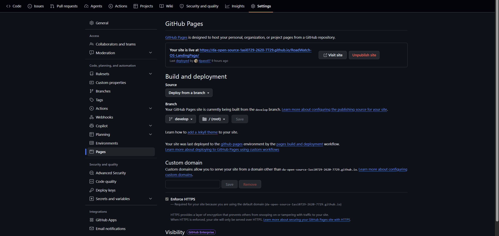
  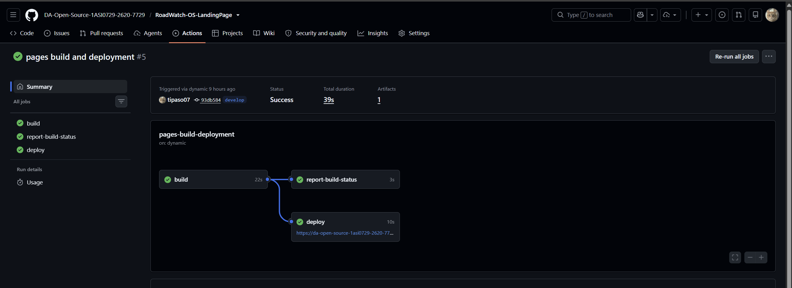
  
  URL del Landing Page desplegado:  
  https://da-open-source-1asi0729-2620-7729.github.io/RoadWatch-OS-LandingPage/
  
  ---
  
  #### 5.2.1.8. Team Collaboration Insights during Sprint
  
  Durante el Sprint 1, todos los miembros del equipo participaron activamente en la implementación del Landing Page, asumiendo responsabilidades sobre secciones específicas según la matriz de líderes y colaboradores definida en la sección 5.2.1.2.
  
  La estrategia de colaboración adoptada fue la siguiente: cada miembro trabajó sobre su rama `feature/<sección>` correspondiente, realizando commits frecuentes con mensajes bajo la convención de Conventional Commits. Una vez completada cada sección, se realizó un Pull Request hacia la rama `develop` para revisión del líder del aspecto correspondiente. Tras la revisión, se realizó el merge y, al concluir el Sprint, se integró `develop` en `main` para el despliegue final.
  
  A continuación, se presentan los analíticos de colaboración del repositorio del Landing Page:
  
  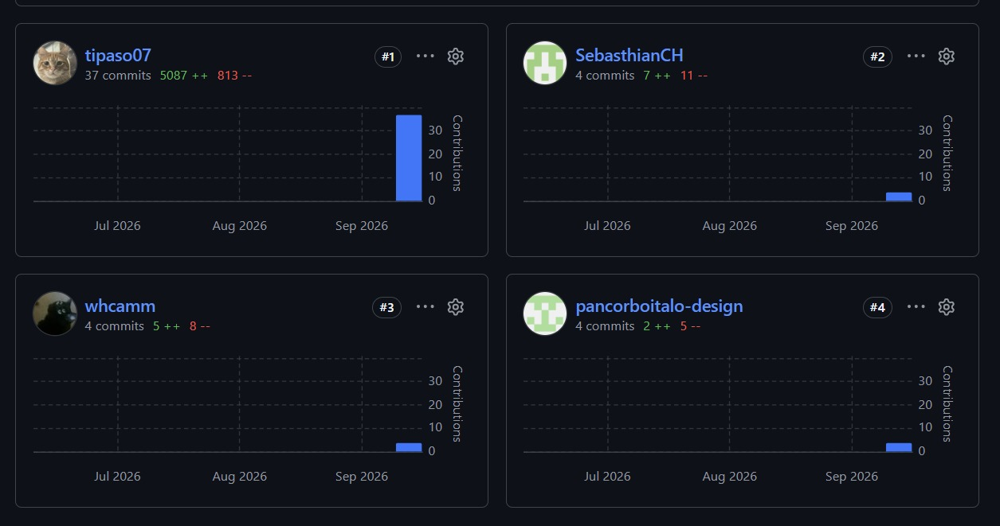
  
  **Resultados e insights de la Landing Page.**
  
  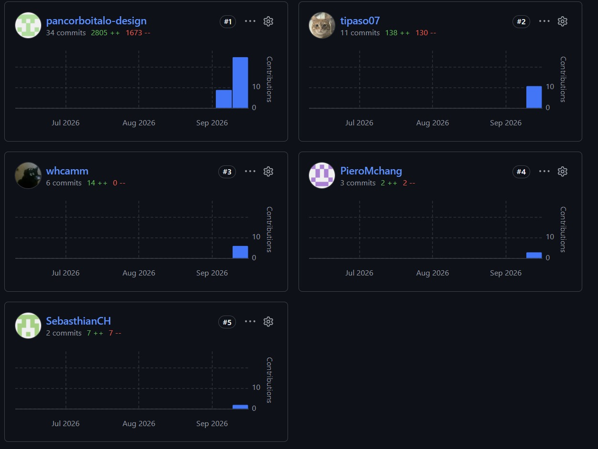
  
  **Resultados e insights del reporte.**
  
  | Miembro del equipo | Contribuciones principales en el Sprint |
  |:---|:---|
  | Cabrera Sotelo, Camila Celeste | Implementación de Navbar y Hero Section; revisión general de responsividad. |
  | Conde Huashuayo, Sebasthian Alex | Sección de Funcionalidades con demo visual del tablero de monitoreo; sección de testimonios y métricas de impacto. |
  | Diaz De La Cruz, Sebastian Gabriel | CTAs diferenciados para segmentos constructora y supervisora; formulario de contacto con validación. |
  | Montes Chang, Piero Francisco | Sección de Planes con tabla comparativa de suscripciones. |
  | Pancorbo Amorós, Italo Raul | Configuración del entorno de despliegue en GitHub Pages; gestión de ramas y merge final a `main`. |
  
  ---
  
  ### 5.2.2. Sprint 2
  
  #### 5.2.2.1. Sprint Planning 2
  
  El Sprint 2 tiene como objetivo principal la implementación y despliegue de la primera versión funcional de la **Frontend Web Application** de RoadWatch OS, abarcando las vistas e interacciones principales de los **7 Bounded Contexts** definidos en la arquitectura (*Identity & Access Management*, *Subscription Management*, *Project Management*, *Environmental Monitoring*, *Incident & Mitigation Management*, *Document & Evidence Management* y *Reports & Compliance Management*), utilizando adaptadores de datos simulados (*Mock Adapters*) para validar los flujos de los segmentos de empresas constructoras viales y empresas supervisoras ambientales.
  
  | Sprint # | Sprint 2 |
  |:---|:---|
  | **Sprint Planning Background** | |
  | Date | 2026-09-22 |
  | Time | 08:00 PM |
  | Location | Reunión virtual vía Discord |
  | Prepared By | Pancorbo Amorós, Italo Raul |
  | Attendees | Cabrera Sotelo, Camila Celeste / Conde Huashuayo, Sebasthian Alex / Diaz De La Cruz, Sebastian Gabriel / Montes Chang, Piero Francisco / Pancorbo Amorós, Italo Raul |
  | Sprint 1 Review Summary | Se completó y desplegó satisfactoriamente la primera versión del Landing Page en GitHub Pages cumpliendo los 19 Story Points comprometidos. Durante la revisión de la entrega AV1 se identificó la necesidad de refinar el alcance del MVP (descartando integraciones directas con sensores físicos IoT e IA) y consolidar el diseño arquitectónico en 7 Bounded Contexts claramente delimitados. |
  | Sprint 1 Retrospective Summary | El equipo acordó mantener la estrategia de ramificación *GitFlow* con *Conventional Commits*, dividir el desarrollo de la Web Application en módulos independientes por *Bounded Context* para evitar conflictos de integración, y emplear un *App Shell* compartido junto con *Mock Adapters* mientras se prepara la implementación del Backend para el siguiente Sprint. |
  | **Sprint Goal & User Stories** | |
  | Sprint 2 Goal | Our focus is on delivering the first functional version of the RoadWatch OS Frontend Web Application deployed in a QA environment. We believe it enables both target segments (road construction companies and environmental supervision consultants) to navigate their tailored workspaces and execute core environmental tracking flows across all 7 Bounded Contexts. This will be confirmed when users can authenticate by profile, manage projects and monitoring points, record and filter environmental measurements, manage alerts and incidents on the Kanban board, attach regulatory documents/evidence, and generate compliance reports. |
  | Sprint 2 Velocity | 32 Story Points |
  | Sum of Story Points | 32 Story Points |
  
  ---
  
  #### 5.2.2.2. Aspect Leaders and Collaborators
  
  Para el Sprint 2, el trabajo se ha paralelizado enfocándose en los **7 Bounded Contexts** de la plataforma. Cada miembro del equipo asume el rol de líder (`L`) en los dominios que le fueron asignados y colabora (`C`) en las integraciones transversales y el *App Shell* compartido.
  
  | Team Member | GitHub Username | Identity & Access | Subscription Mgmt | Project Mgmt | Env. Monitoring | Incident & Mitigation | Document & Evidence | Reports & Compliance |
  |:---|:---|:---:|:---:|:---:|:---:|:---:|:---:|:---:|
  | Cabrera Sotelo, Camila Celeste | *whcamm* | L | L | | | C | C | |
  | Conde Huashuayo, Sebasthian Alex | *SebasthianCH* | C | | L | C | | | |
  | Diaz De La Cruz, Sebastian Gabriel | *tipaso07* | C | | C | | | L | L |
  | Montes Chang, Piero Francisco | *PieroMchang* | | | C | L | | | C |
  | Pancorbo Amorós, Italo Raul | *pancorboitalo-design* | | C | | | L | C | |
  
  *L = Líder | C = Colaborador*
  
  ---
  
  #### 5.2.2.3. Sprint Backlog 2
  
  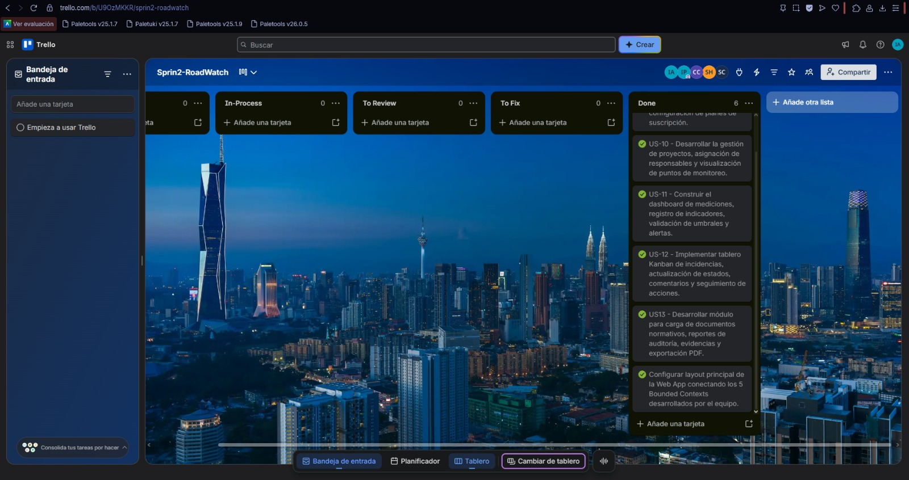
  
  > **URL del Board en Trello:** https://trello.com/invite/b/6ac45a47333a77ed1bb96de5/ATTId01870fd734279c8b64b2e32744d1f60715FC467/sprin2-roadwatch
  
  El objetivo de este Sprint es establecer la primera versión funcional de la Web Application cubriendo los **7 Bounded Contexts** del sistema, asegurando que tanto las empresas constructoras viales como las supervisoras y consultoras ambientales puedan interactuar con sus respectivos módulos y flujos de trabajo.
  
  | **Story Id** | **Story Title** | **Task Id** | **Task Title** | **Task Description** | **Estimation (Hours)** | **Assigned To** | **Status** |
  |:---|:---|:---|:---|:---|:---|:---|:---|
  | US01 / US21 | Autenticación y Login Minimalista | T01 | Login y gestión de sesiones por segmento | Implementar la vista de autenticación minimalista con selector de perfiles demostrativos por segmento (*Identity & Access Management*). | 4 | Cabrera Sotelo, Camila | Done |
  | US23 | Selector de Color de Marca y Suscripción | T02 | Configuración de planes y cuenta | Implementar el módulo visual de planes de suscripción, cuotas operativas y preferencias de cuenta (*Subscription Management*). | 3 | Cabrera Sotelo, Camila | Done |
  | US10 / US22 | Tarjetas y Lista de Proyectos | T03 | Gestión de portafolio y puntos de monitoreo | Desarrollar las vistas en tarjetas y tabla de proyectos viales, detalle de obra y visualización de puntos de monitoreo (*Project Management*). | 5 | Conde Huashuayo, Sebasthian | Done |
  | US09 / US13 | Registro y Filtro de Indicadores | T04 | Dashboard ambiental, mediciones y alertas | Construir el formulario validado de registro de mediciones, filtros por tipo de indicador (aire, ruido, agua), historial y centro de alertas (*Environmental Monitoring*). | 5 | Montes Chang, Piero | Done |
  | US11 / US18 | Tablero Kanban e Incidencias Críticas | T05 | Kanban de incidencias y seguimiento de mitigación | Implementar el tablero Kanban interactivo, listado de incidencias críticas, detalle de acciones de mitigación e historial de comentarios (*Incident & Mitigation Management*). | 5 | Pancorbo Amorós, Italo | Done |
  | US14 | Adjuntar Evidencia Fotográfica y Documentos | T06 | Repositorio de evidencias y documentos normativos | Desarrollar las vistas de carga y consulta de evidencias fotográficas y control de documentos obligatorios por hito (*Document & Evidence Management*). | 4 | Diaz De La Cruz, Sebastian | Done |
  | US15 / US19 | Progreso de Cumplimiento y Reportes | T07 | Generación y exportación visual de reportes | Implementar el flujo de generación de reportes de auditoría, filtros por rango de fechas e indicadores de cumplimiento (*Reports & Compliance Management*). | 4 | Diaz De La Cruz, Sebastian | Done |
  | — | Integración Global (App Shell) | T08 | Enrutamiento e interfaz base compartida | Configurar el *layout* principal responsivo y la navegación diferenciada por rol conectando los 7 Bounded Contexts desarrollados por el equipo. | 4 | Pancorbo Amorós, Italo | Done |
  
  ---
  
  #### 5.2.2.4. Development Evidence for Sprint Review
  
  Durante el Sprint 2, el equipo trabajó sobre el repositorio de la Frontend Web Application, organizando la implementación por Bounded Contexts. Los commits evidencian el desarrollo modular de las principales funcionalidades de la aplicación y su integración progresiva.
  
  | Repository | Branch | Commit Id | Commit Message | Commit Message Body | Commited on (Date) |
  |:---|:---|:---|:---|:---|:---|
  | DA-Open-Source-1ASI0729-2620-7729/RoadWatch-OS-Frontend | ft-identity-access-management | `0841063c9a2cc3e8287a8f6d738ed89db03ca648` | `feat(identity-access): add mock authentication module` | Se implementó el módulo de autenticación mock para la interfaz de acceso y gestión básica de sesión. | 2026-10-05 |
  | DA-Open-Source-1ASI0729-2620-7729/RoadWatch-OS-Frontend | ft-subscription-management | `a180fc98dba70012f29bd1e649ecbabcb7b59b36` | `feat(subscription): add plans and subscription management module` | Se implementó el módulo de planes y gestión visual de suscripciones. | 2026-10-05 |
  | DA-Open-Source-1ASI0729-2620-7729/RoadWatch-OS-Frontend | ft-project-management | `26d2ed911713894be678ff7bc7fc4bbe75ab3e1e` | `feat(projects): add project detail view` | Se agregó la vista de detalle de proyectos y la estructura de navegación asociada. | 2026-10-06 |
  | DA-Open-Source-1ASI0729-2620-7729/RoadWatch-OS-Frontend | ft-project-management | `81e0ef31eac900337b3d6e8f7875161d122f374a` | `refactor(projects): adopt shared shell for portfolio views` | Se integraron las vistas de Project Management con el App Shell compartido. | 2026-10-06 |
  | DA-Open-Source-1ASI0729-2620-7729/RoadWatch-OS-Frontend | ft-environmental-monitoring | `548943a` | `feat(monitoring): add mock domain and data layer` | Se implementó la capa de dominio y adaptadores de datos simulados para mediciones y alertas ambientales. | 2026-10-05 |
  | DA-Open-Source-1ASI0729-2620-7729/RoadWatch-OS-Frontend | ft-environmental-monitoring | `2f6c921` | `feat(monitoring): add operational monitoring views` | Se agregaron las vistas operativas de monitoreo ambiental, registro de mediciones y centro de alertas. | 2026-10-05 |
  | DA-Open-Source-1ASI0729-2620-7729/RoadWatch-OS-Frontend | ft-incident-mitigation-management | `a9b90f966998e676ae4bdede115e1cb403cce1f1` | `feat(incidents): complete critical list and detail views` | Se completaron las vistas de incidencias críticas y detalle de incidencias. | 2026-10-06 |
  | DA-Open-Source-1ASI0729-2620-7729/RoadWatch-OS-Frontend | ft-incident-mitigation-management | `7ab180dcca4e4bcd2db12083e88345446bb6ac5d` | `refactor(incidents): adopt shared navigation and shell` | Se integró Incident & Mitigation Management con la navegación y estructura compartidas. | 2026-10-06 |
  | DA-Open-Source-1ASI0729-2620-7729/RoadWatch-OS-Frontend | ft-document-evidence-management | `556220c2f16fe88252cae0a9d3497d76ad4edcdc` | `feat(document-evidence): add evidence and required document views` | Se agregaron las vistas de evidencias y documentos requeridos. | 2026-10-05 |
  | DA-Open-Source-1ASI0729-2620-7729/RoadWatch-OS-Frontend | ft-document-evidence-management | `6f4dffe53a56a5dff85044a55ab95cb556387265` | `feat(document-evidence): complete document registration flow` | Se completó el flujo visual de registro y gestión de documentos. | 2026-10-05 |
  | DA-Open-Source-1ASI0729-2620-7729/RoadWatch-OS-Frontend | ft-reports-compliance-management | `f287c233ce1716c0d802142ff41285a6d2e39cff` | `feat(reports-compliance): connect audit generation flow` | Se conectó el flujo de generación visual de reportes de auditoría. | 2026-10-05 |
  | DA-Open-Source-1ASI0729-2620-7729/RoadWatch-OS-Frontend | ft-reports-compliance-management | `09d3800555ff208cc10139cafc348ea667b7383b` | `feat(reports-compliance): complete report export workflow` | Se completó el flujo visual de exportación de reportes. | 2026-10-05 |
  | DA-Open-Source-1ASI0729-2620-7729/RoadWatch-OS-Frontend | ft-reports-compliance-management | `e7aa7a1bc9934ffa8020c21cb01b6d02f43cb786` | `feat(reports-compliance): add report and compliance filters` | Se agregaron filtros para reportes y vistas de cumplimiento. | 2026-10-05 |
  
  ---
  
  #### 5.2.2.5. Execution Evidence for Sprint Review
  
  Al finalizar el Sprint 2, la Web Application cuenta con la estructura funcional de los **7 Bounded Contexts** definidos en la arquitectura. Los usuarios pueden iniciar sesión según su segmento (Empresa Constructora Vial o Empresa Supervisora / Consultora Ambiental), gestionar sus planes de suscripción, visualizar su portafolio de proyectos y puntos de monitoreo, registrar y consultar mediciones y alertas ambientales, gestionar incidencias y acciones de mitigación mediante un tablero Kanban interactivo, adjuntar evidencias y documentos normativos, y generar reportes consolidados de cumplimiento.
  
  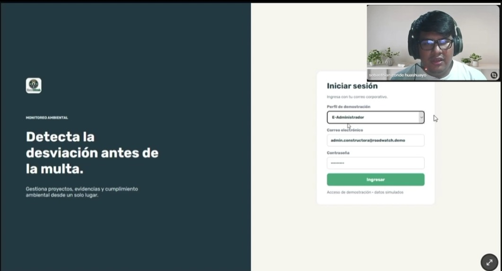
  **Video de navegación de la Web Application (Sprint 2):**  
  
  [Ver video de demostración del Sprint 2](https://upcedupe-my.sharepoint.com/:v:/g/personal/u202418029_upc_edu_pe/IQCFRFdP6q8ZRJBC7Daji-IfAVr9wVVrikD0aTOqE_KlONk?e=uweOJY)
  
  ---
  
  #### 5.2.2.6. Services Documentation Evidence for Sprint Review
  
  Durante el Sprint 2, el alcance de implementación correspondió a la primera versión funcional de la **Frontend Web Application**, la cual opera mediante capas de dominio y adaptadores de datos simulados (*Mock Adapters*). En paralelo, se definieron las rutas y contratos esperados de la API RESTful (OpenAPI / Swagger) para los **7 Bounded Contexts**, cuya implementación en el Backend se realizará a partir del Sprint 3:
  
  | Bounded Context | Endpoint Principal Proyectado | Acción | Estado en Sprint 2 |
  |:---|:---|:---|:---|
  | Identity & Access Management | `POST /api/v1/auth/login` | Autenticación de usuarios y emisión de sesión | Definido (Mock en Frontend / Pendiente Backend en Sprint 3) |
  | Subscription Management | `GET /api/v1/subscriptions/current` | Consulta y actualización de plan de suscripción | Definido (Mock en Frontend / Pendiente Backend en Sprint 3) |
  | Project Management | `GET /api/v1/projects` | Gestión de proyectos viales y puntos de monitoreo | Definido (Mock en Frontend / Pendiente Backend en Sprint 3) |
  | Environmental Monitoring | `POST /api/v1/measurements` | Registro de mediciones ambientales y evaluación de alertas | Definido (Mock en Frontend / Pendiente Backend en Sprint 3) |
  | Incident & Mitigation Management | `PATCH /api/v1/incidents/{id}/status` | Gestión de estados de incidencias y acciones de mitigación | Definido (Mock en Frontend / Pendiente Backend en Sprint 3) |
  | Document & Evidence Management | `POST /api/v1/documents` | Registro de evidencias fotográficas y documentos normativos | Definido (Mock en Frontend / Pendiente Backend en Sprint 3) |
  | Reports & Compliance Management | `GET /api/v1/reports/compliance` | Consolidación de indicadores y generación de reportes de auditoría | Definido (Mock en Frontend / Pendiente Backend en Sprint 3) |
  
  ---
  
  #### 5.2.2.7. Software Deployment Evidence for Sprint Review
  
  La primera versión funcional de la Frontend Web Application fue integrada y desplegada en **Vercel** como entorno de validación y pruebas (QA):
  
  1. **Integración de ramas en GitHub:** Cada módulo desarrollado en su respectiva rama `ft-<bounded-context>` fue revisado e integrado en la rama `develop` y posteriormente consolidado en `main`.
  2. **Configuración de despliegue continuo en Vercel:** Se vinculó el repositorio `RoadWatch-OS-Frontend` con Vercel, configurando el comando de compilación de Angular (`npm run build`) y las reglas de reescritura (`vercel.json`) para soportar el enrutamiento SPA (*Single-Page Application*).
  3. **Verificación del entorno desplegado:** Se validó el acceso público a través de la URL generada por Vercel, comprobando el funcionamiento de los perfiles demostrativos de ambos segmentos y la navegación entre los 7 Bounded Contexts con datos simulados.
  
  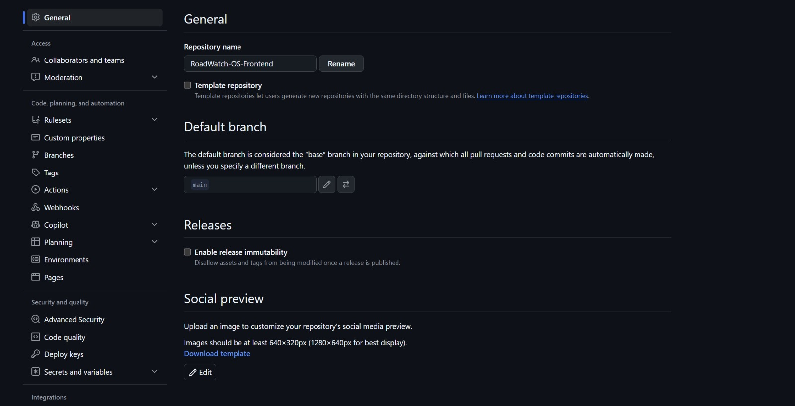
  
  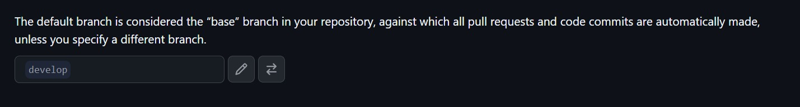
  
  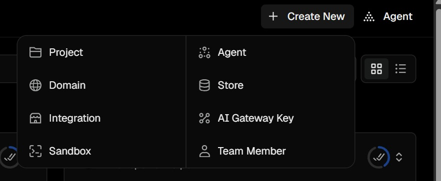
  
  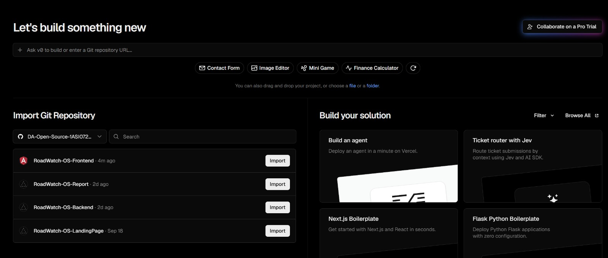
  
  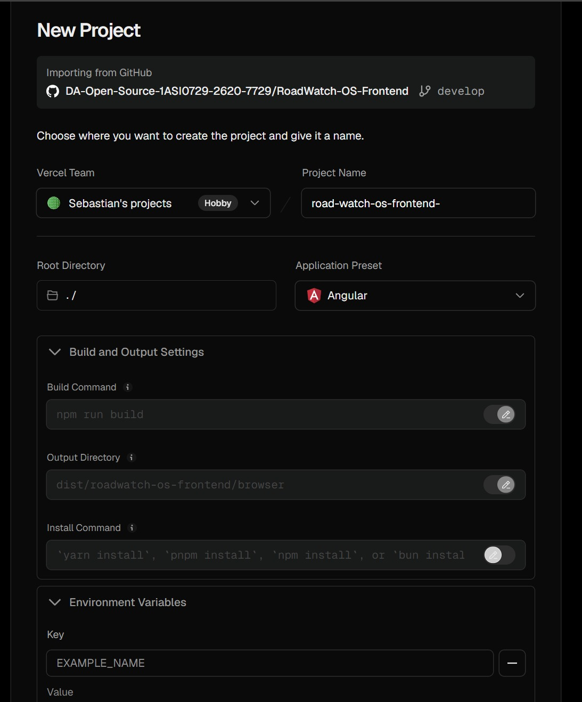
  
  
  
  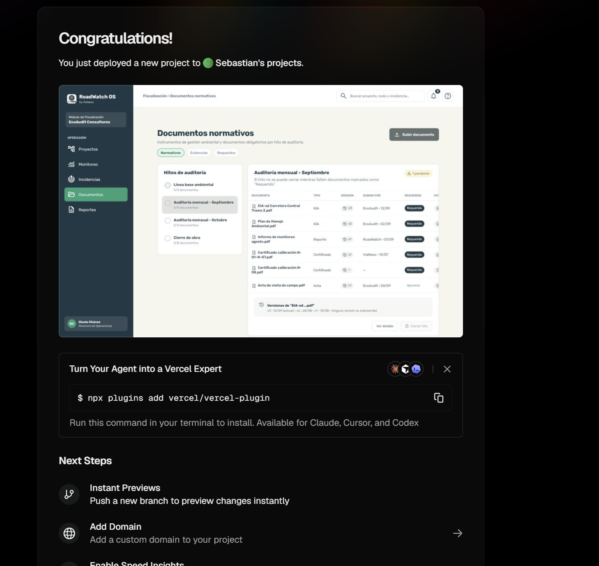
  
  
  URL de la Web Application desplegada (QA):  
  
  [*(Enlace al entorno de QA de VíaNexo / RoadWatch OS)*](https://road-watch-os-frontend.vercel.app/auth/login)
  
  ---
  
  #### 5.2.2.8. Team Collaboration Insights during Sprint
  
  La estrategia colaborativa de este Sprint consistió en la separación modular de responsabilidades por *Bounded Context* ("Divide y Vencerás"). Cada integrante trabajó dentro del directorio de su contexto asignado en el repositorio `RoadWatch-OS-Frontend` sobre ramas `ft-<bounded-context>`, reduciendo los conflictos de fusión (*Merge Conflicts*) al momento de integrar las vistas en el *App Shell* principal.
  
  | Miembro del equipo | Contribuciones principales en el Sprint 2 |
  |:---|:---|
  | Cabrera Sotelo, Camila Celeste | Implementó los módulos frontend de *Identity & Access Management* (login segmentado) y *Subscription Management* (planes y configuración de suscripción), además de elaborar los prototipos y flujos UX/UI. |
  | Conde Huashuayo, Sebasthian Alex | Desarrolló el módulo de *Project Management*, incluyendo las vistas de portafolio de proyectos, detalle de proyecto y visualización de puntos de monitoreo viales. |
  | Diaz De La Cruz, Sebastian Gabriel | Desarrolló los módulos de *Document & Evidence Management* y *Reports & Compliance Management*, integró el *App Shell* compartido entre contextos y configuró el despliegue continuo en Vercel. |
  | Montes Chang, Piero Francisco | Construyó el módulo de *Environmental Monitoring*, abarcando el panel de indicadores, el formulario validado de registro de mediciones, el historial y el centro de alertas ambientales. |
  | Pancorbo Amorós, Italo Raul | Desarrolló el módulo de *Incident & Mitigation Management* (tablero Kanban interactivo, listado de incidencias críticas y detalle de acciones de mitigación) y apoyó en la integración general del Sprint 2. |
  
  
  Evidencia de insights del reporte:
  
  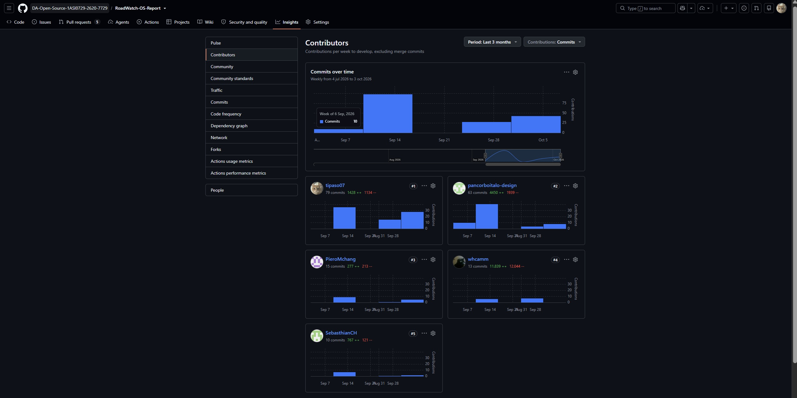
  
  
  Evidencia insights de la landing page:
  
  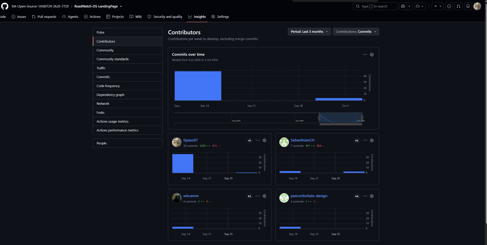
  
  
  Evidencia insights del front:
  
  
  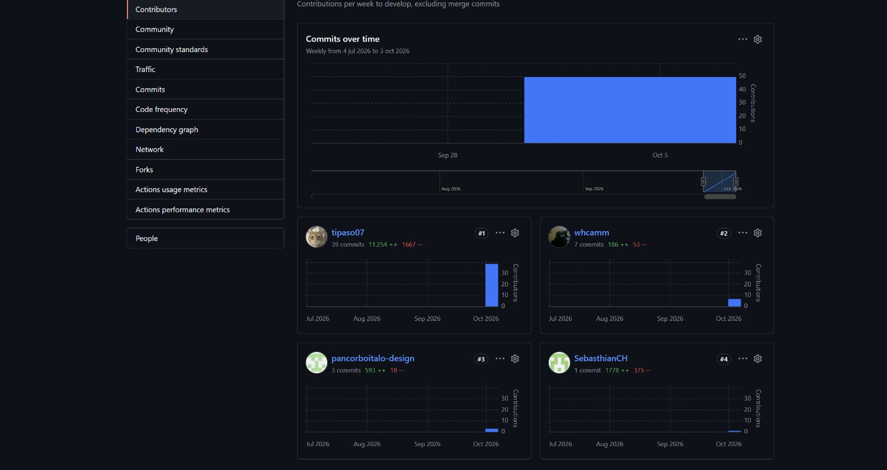
  
  
  
  ---
  
  ### 5.2.3. Sprint 3
  
  #### 5.2.3.1. Sprint Planning 3
  
  El Sprint 3 se orienta a implementar la **RESTful API** de RoadWatch OS en el repositorio `RoadWatch-OS-Backend`, organizada en los siete *Bounded Contexts* definidos en la arquitectura. La primera versión funcional del frontend del Sprint 2 utiliza adaptadores de datos simulados; este Sprint prepara los servicios de backend que permitirán sustituirlos de manera gradual. Las implementaciones de las ramas feature ya se integraron en `develop`. Las capturas de Railway documentan el despliegue del backend y MySQL; la validación de los flujos REST y de la persistencia desde la API sigue pendiente de evidencia.
  
  | Sprint # | Sprint 3 |
  |:---|:---|
  | **Sprint Planning Background** | |
  | Date, Time and Location | Pendientes de registro por el equipo. |
  | Sprint 2 Review Summary | El Sprint 2 entregó la primera versión funcional de la Web Application para los siete Bounded Contexts, desplegada en un entorno de QA con *Mock Adapters*. |
  | Sprint 2 Retrospective Summary | Se mantiene el trabajo por Bounded Context y rama feature, con contratos REST y referencias por ID para reducir el acoplamiento entre módulos. |
  | **Sprint Goal & User Stories** | |
  | Sprint 3 Goal | Implementar y documentar los servicios REST principales de los siete Bounded Contexts, con persistencia relacional, reglas de dominio y servicios de aplicación separados para comandos y consultas. La meta se confirmará cuando los endpoints estén integrados, sean visibles en Swagger UI y puedan ejecutarse contra la base de datos del equipo. |
  | Velocity Reference | 32 Story Points del Sprint 2; la capacidad y el compromiso de Sprint 3 requieren estimación del equipo. |
  | Sum of Story Points | Pendiente de confirmación en Sprint Planning 3. |
  
  ---
  
  #### 5.2.3.2. Aspect Leaders and Collaborators
  
  La asignación siguiente refleja **autoría observada en los commits de las ramas remotas del backend al 2026-11-10**. Identifica responsables de trabajo visible para organizar el backlog; no sustituye la confirmación de roles y carga de trabajo por el equipo. Los commits iniciales de preparación de los BCs fueron realizados por Sebastián Díaz.
  
  | Bounded Context | Rama de backend | Contribuidores observados | Evidencia representativa |
  |:---|:---|:---|:---|
  | Identity & Access / Subscription Management | `ft-identity-subscription` | Diaz De La Cruz, Sebastian Gabriel (`Sebastián Díaz`) | `118446f` autenticación; `2b2fe9d` planes y suscripciones; `8b40d9b` cuotas. |
  | Project Management | `ft-project-management` | Pancorbo Amorós, Italo Raul (`pancorboitalo-design`); Diaz De La Cruz, Sebastian Gabriel (`Sebastián Díaz`) | `c8db7b8` modelo de proyecto; `b4fc0f0` API REST; `1bccba4` ajuste de persistencia. |
  | Environmental Monitoring | `ft-environmental-monitoring` | Montes Chang, Piero Francisco (`PieroMchang`); Diaz De La Cruz, Sebastian Gabriel (`Sebastián Díaz`) | `4bf3bef` modelo de dominio; `a0f0fa5` endpoints; `f34282c` validación de umbrales. |
  | Incident & Mitigation Management | `ft-incident-mitigation` | Cabrera Sotelo, Camila Celeste (`whcamm`); Diaz De La Cruz, Sebastian Gabriel (`Sebastián Díaz`) | `b6dc904` modelo de incidencias; `4c7d0dc` API REST; `9760432` revisión de vencimientos. |
  | Document & Evidence / Reports & Compliance Management | `ft-document-reports` | Conde Huashuayo, Sebasthian Alex (`SebasthianCH`); Diaz De La Cruz, Sebastian Gabriel (`Sebastián Díaz`) | `d9c4912` documentos; `8d4d122` reportes; `968fda9` exportación PDF. |
  
  Para mantener el formato de los Sprints anteriores, la matriz siguiente resume las responsabilidades **inferidas de la autoría de commits**: `L` indica quien realizó la implementación principal del aspecto y `C` una contribución registrada. La autoría de los merges atribuye la coordinación técnica de la integración a Sebastián Díaz. El equipo debe confirmar si estos roles coinciden con los acordados en el Sprint Planning.
  
  | Team Member | GitHub Username | Identity & Access | Subscription Mgmt | Project Mgmt | Env. Monitoring | Incident & Mitigation | Document & Evidence | Reports & Compliance | Integración backend |
  |:---|:---|:---:|:---:|:---:|:---:|:---:|:---:|:---:|:---:|
  | Diaz De La Cruz, Sebastian Gabriel | *tipaso07* | L | L | C | C | C | C | C | L |
  | Pancorbo Amorós, Italo Raul | *pancorboitalo-design* | | | L | | | | | |
  | Montes Chang, Piero Francisco | *PieroMchang* | | | | L | | | | |
  | Cabrera Sotelo, Camila Celeste | *whcamm* | | | | | L | | | |
  | Conde Huashuayo, Sebasthian Alex | *SebasthianCH* | | | | | | L | L | |
  
  *L = implementación principal observada | C = contribución observada. Las celdas vacías no implican ausencia de colaboración fuera de los commits examinados.*
  
  ---
  
  #### 5.2.3.3. Sprint Backlog 3
  
  Las tareas se trazan a las User Stories del Product Backlog y al trabajo integrado en `develop` al 2026-11-11. El estado distingue la integración del código de la validación funcional con MySQL y la aceptación de las historias. Las horas y el compromiso final deben acordarse en Sprint Planning.
  
  | **Story Id** | **Story Title** | **Task Id** | **Task Title** | **Task Description** | **Estimation (Hours)** | **Assigned To** | **Status** |
  |:---|:---|:---|:---|:---|:---|:---|:---|
  | US24 / US32 / US53 | Autenticación, contraseñas y roles | T01 | API de Identity & Access | Implementar usuarios, autenticación JWT, roles, permisos y operaciones de cuenta mediante controladores, servicios de aplicación y persistencia propios del BC. | Por estimar | Diaz De La Cruz, Sebastian | Integrado en `develop`; validación funcional pendiente |
  | US39 / US57 | Planes y cuotas de suscripción | T02 | API de Subscription Management | Exponer planes, suscripciones y consulta de cuotas; acordar el contrato que Project Management utilizará antes de crear proyectos. | Por estimar | Diaz De La Cruz, Sebastian | Integrado en `develop`; contrato de cuotas por validar |
  | US26 / US20 / US48 | Proyectos y puntos de monitoreo | T03 | API de Project Management | Implementar proyectos, puntos de monitoreo, archivo y consulta paginada; verificar referencias externas por ID y persistencia en MySQL. | Por estimar | Pancorbo Amorós, Italo; Diaz De La Cruz, Sebastian | Integrado en `develop`; validación con MySQL pendiente |
  | US27 / US28 | Mediciones y comparación normativa | T04 | API de Environmental Monitoring | Registrar y consultar mediciones, configurar umbrales y evaluar alertas ambientales, conservando `monitoringPointId` como referencia al BC de proyectos. | Por estimar | Montes Chang, Piero; Diaz De La Cruz, Sebastian | Integrado en `develop`; validación funcional pendiente |
  | US29 / US34 / US43 | Incidencias y mitigación | T05 | API de Incident & Mitigation | Gestionar incidencias, acciones, comentarios, transiciones de estado y revisión de vencimientos; acordar el contrato de alertas con Environmental Monitoring. | Por estimar | Cabrera Sotelo, Camila; Diaz De La Cruz, Sebastian | Integrado en `develop`; validación funcional pendiente |
  | US30 / US54 / US56 | Evidencias y documentos normativos | T06 | API de Document & Evidence | Gestionar evidencias, documentos obligatorios y versiones con consultas por IDs de los contextos relacionados. | Por estimar | Conde Huashuayo, Sebasthian; Diaz De La Cruz, Sebastian | Integrado en `develop`; validación funcional pendiente |
  | US33 / US35 / US36 | Cumplimiento y reportes | T07 | API de Reports & Compliance | Consolidar indicadores y datos históricos por proyecto, generar reportes y exponer la exportación a PDF mediante contratos con los BCs fuente. | Por estimar | Conde Huashuayo, Sebasthian; Diaz De La Cruz, Sebastian | Integrado en `develop`; validación funcional pendiente |
  | US25 / US31 | Swagger y paginación | T08 | Documentación y consultas REST | Publicar los endpoints en `/swagger-ui/index.html`, documentar solicitudes y respuestas, y verificar paginación en los listados aplicables. | Por estimar | Equipo de backend, por BC | Código integrado; revisión de Swagger UI en ejecución pendiente |
  | US26 / US27 / US29 / US30 / US35 | Integración de servicios | T09 | Validación integrada del backend | Integrar las ramas revisadas, resolver contratos entre contextos y comprobar los flujos REST y la persistencia contra la base MySQL del equipo antes del Sprint Review. | Por estimar | Equipo de backend | Ramas integradas; flujo REST y MySQL pendientes de validación |
  
  ---
  
  #### 5.2.3.4. Development Evidence for Sprint Review
  
  El historial del repositorio `RoadWatch-OS-Backend` muestra avances en las ramas feature de los siete *Bounded Contexts*. La tabla reúne **commits representativos**, no el historial completo. Se registran el hash, autor, rama, mensaje y fecha observados en Git; los commits seleccionados no incluyen cuerpo de mensaje. Esta evidencia demuestra trabajo registrado en cada rama, pero no acredita por sí sola la integración en `develop`, la ejecución con MySQL ni la aceptación de las User Stories.
  
  | Repository | Branch | Commit Id | Author | Commit Message | Commited on (Date) |
  |:---|:---|:---|:---|:---|:---|
  | DA-Open-Source-1ASI0729-2620-7729/RoadWatch-OS-Backend | `develop` (base de las ramas feature) | `ba3b8d73daf19f58fa922ef6a8a417f0b8cfb10e` | Sebastián Díaz | `chore(backend): initialize spring boot foundation` | 2026-11-08 |
  | DA-Open-Source-1ASI0729-2620-7729/RoadWatch-OS-Backend | `ft-identity-subscription` | `118446f0670f9a5bf02a326d442b531602b22689` | Sebastián Díaz | `feat(iam): implement authentication and token handling` | 2026-11-10 |
  | DA-Open-Source-1ASI0729-2620-7729/RoadWatch-OS-Backend | `ft-identity-subscription` | `2b2fe9d7df362d4dbf20b2eec738b2129d7f3434` | Sebastián Díaz | `feat(subscription): implement plans and subscriptions` | 2026-11-10 |
  | DA-Open-Source-1ASI0729-2620-7729/RoadWatch-OS-Backend | `ft-identity-subscription` | `8b40d9b481a244ae09d72618f6b4b2f9d4eff7a6` | Sebastián Díaz | `feat(subscription): expose plans and quota facade` | 2026-11-10 |
  | DA-Open-Source-1ASI0729-2620-7729/RoadWatch-OS-Backend | `ft-project-management` | `c8db7b8cbc2fb70c48c1b41a5e311a7e994afc62` | pancorboitalo-design | `feat(projects): add project domain model` | 2026-11-08 |
  | DA-Open-Source-1ASI0729-2620-7729/RoadWatch-OS-Backend | `ft-project-management` | `b4fc0f09ea1e3b87f2848a67dc34f8ec5f843461` | pancorboitalo-design | `feat(projects): expose project REST API` | 2026-11-09 |
  | DA-Open-Source-1ASI0729-2620-7729/RoadWatch-OS-Backend | `ft-project-management` | `a7e59f44628427a5674e321a8af6579177507062` | pancorboitalo-design | `feat(projects): add monitoring point services and REST API` | 2026-11-09 |
  | DA-Open-Source-1ASI0729-2620-7729/RoadWatch-OS-Backend | `ft-project-management` | `1bccba43e47ed69b82e399503092ce0b74177dfd` | Sebastián Díaz | `fix(projects): align persistence table names` | 2026-11-10 |
  | DA-Open-Source-1ASI0729-2620-7729/RoadWatch-OS-Backend | `ft-environmental-monitoring` | `4bf3bef785492a778f213c4035593bdf6babe80b` | PieroMchang | `feat(monitoring): add environmental monitoring domain model and services` | 2026-11-09 |
  | DA-Open-Source-1ASI0729-2620-7729/RoadWatch-OS-Backend | `ft-environmental-monitoring` | `a0f0fa56487701065fc74e42579e2fe592242fd6` | PieroMchang | `feat(monitoring): expose environmental monitoring rest endpoints and assemblers` | 2026-11-09 |
  | DA-Open-Source-1ASI0729-2620-7729/RoadWatch-OS-Backend | `ft-environmental-monitoring` | `f34282c007dc196ff7a606f993d045da6a023706` | Sebastián Díaz | `feat(monitoring): add threshold checks` | 2026-11-10 |
  | DA-Open-Source-1ASI0729-2620-7729/RoadWatch-OS-Backend | `ft-incident-mitigation` | `b6dc9043f677ce76274594975c96c52f076577bc` | whcamm | `feat(incidents): add environmental incident domain model` | 2026-11-09 |
  | DA-Open-Source-1ASI0729-2620-7729/RoadWatch-OS-Backend | `ft-incident-mitigation` | `4c7d0dc9ba3fa73ff46e00b9c920e9ac914d97b3` | whcamm | `feat(incidents): expose environmental incident REST API` | 2026-11-09 |
  | DA-Open-Source-1ASI0729-2620-7729/RoadWatch-OS-Backend | `ft-incident-mitigation` | `9760432d14a30ebaa1423b416a5a5082d75d4c8a` | Sebastián Díaz | `feat(incidents): schedule overdue incident checks` | 2026-11-10 |
  | DA-Open-Source-1ASI0729-2620-7729/RoadWatch-OS-Backend | `ft-document-reports` | `d9c4912f050e438605aa15bef506eea52b946a29` | SebasthianCH | `feat(documentevidence): add NormativeDocument aggregate` | 2026-11-09 |
  | DA-Open-Source-1ASI0729-2620-7729/RoadWatch-OS-Backend | `ft-document-reports` | `1b32b54440c2f4092a4c0205f282cee10735acdc` | SebasthianCH | `feat(documentevidence): add REST controllers` | 2026-11-09 |
  | DA-Open-Source-1ASI0729-2620-7729/RoadWatch-OS-Backend | `ft-document-reports` | `8d4d122a0868a2a3864a61aadb112f2b8132a375` | SebasthianCH | `feat(reportscompliance): add AuditReport aggregate` | 2026-11-09 |
  | DA-Open-Source-1ASI0729-2620-7729/RoadWatch-OS-Backend | `ft-document-reports` | `08a9965949f2491b7a8588ae1e5824f8a92d8bf7` | SebasthianCH | `feat(reportscompliance): add REST resources, assembler and controller` | 2026-11-10 |
  | DA-Open-Source-1ASI0729-2620-7729/RoadWatch-OS-Backend | `ft-document-reports` | `968fda94578710e6f368834b69565d5a449c4f6c` | Sebastián Díaz | `feat(reportscompliance): expose report pdf endpoint` | 2026-11-10 |
  
  La evidencia corresponde a las ramas remotas consultadas el 2026-11-11. La integración en `develop` y las pruebas automatizadas se detallan a continuación. Las capturas de Railway documentan el despliegue y la presencia de tablas en MySQL, pero no una operación de la API contra esa base.
  
  
  ---
  
  #### 5.2.3.5. Execution Evidence for Sprint Review
  
  Al 2026-11-11, la rama remota `origin/develop` del backend apunta a `c4b27dca9b4e0b859431a5a75a1e88ef15d53a91`. Los commits de integración `514f57d` (Identity & Access y Subscription), `b9dd05b` (Project Management), `01d28b0` (Environmental Monitoring), `f15e92d` (Incident & Mitigation) y `90504a0` (Document & Evidence y Reports & Compliance) figuran en su historial. Los extremos de las cinco ramas feature son ancestros de `origin/develop`. También figuran los cambios de integración entre alertas e incidencias (`63c20f4`) y de validación de evidencias de incidencias (`c4b27dc`).
  
  Para comprobar el estado integrado sin alterar las ramas de trabajo, se extrajo una copia temporal del contenido de `origin/develop` y se ejecutaron los comandos siguientes con el JDK disponible en el entorno de revisión:
  
  | Verificación | Comando | Resultado observado |
  |:---|:---|:---|
  | Compilación del backend integrado | `mvnw.cmd -q -DskipTests compile` | Finalizó correctamente. |
  | Pruebas automatizadas sin la prueba que inicia el contexto con MySQL | `mvnw.cmd -q '-Dtest=*,!RoadwatchOsBackendApplicationTests' test` | 21 suites; 56 pruebas; 0 fallos, 0 errores y 0 omitidas, según los informes Surefire. |
  
  La prueba `RoadwatchOsBackendApplicationTests` se excluyó porque requiere iniciar la aplicación con una base MySQL local. Este resultado verifica la compilación y las pruebas seleccionadas del código integrado; no acredita conexión real a MySQL, migración de datos, funcionamiento de todos los flujos HTTP ni aceptación de las User Stories. Los informes revisados incluyen pruebas de Project Management, Incident & Mitigation, Document & Evidence, Reports & Compliance y la integración entre mediciones ambientales e incidencias. No se identificaron suites dedicadas a Identity & Access o Subscription Management en esta ejecución.
  
  ---
  
  #### 5.2.3.6. Services Documentation Evidence for Sprint Review
  
  La siguiente relación se obtuvo de las rutas declaradas por los controladores REST en `origin/develop` al 2026-11-11. Registra la superficie disponible en el código integrado. Las capturas posteriores muestran Swagger UI publicado en Railway, con endpoints y esquemas visibles; no verifican la ejecución exitosa de cada operación.
  
  | Bounded Context | Rutas representativas implementadas | Alcance verificable en código |
  |:---|:---|:---|
  | Identity & Access Management | `POST /api/v1/auth/login`; `POST /api/v1/users`; `GET /api/v1/users/{userId}`; `POST /api/v1/roles` | Autenticación, usuarios y roles. |
  | Subscription Management | `GET /api/v1/plans`; `GET /api/v1/plans/{planId}` | Consulta de planes y fachada interna de cuotas; no se identificó `GET /api/v1/subscriptions/current`. |
  | Project Management | `GET /api/v1/projects`; `POST /api/v1/projects`; `GET /api/v1/projects/{projectId}`; `PUT /api/v1/projects/{projectId}`; `GET /api/v1/projects/{projectId}/monitoring-points` | Proyectos y puntos de monitoreo. |
  | Environmental Monitoring | `GET /api/v1/environmental-measurements`; `POST /api/v1/environmental-measurements`; `GET /api/v1/normative-thresholds`; `GET /api/v1/environmental-alerts` | Mediciones, umbrales y alertas. |
  | Incident & Mitigation Management | `GET /api/v1/incidents`; `POST /api/v1/incidents`; `PATCH /api/v1/incidents/{incidentId}/status` | Incidencias, estado y recursos relacionados de comentarios y mitigación. |
  | Document & Evidence Management | `/api/v1/evidences`; `/api/v1/normative-documents`; `/api/v1/required-documents` | Recursos de evidencias y documentos. |
  | Reports & Compliance Management | `GET /api/v1/reports`; `POST /api/v1/reports`; `GET /api/v1/reports/{reportId}/pdf`; `GET /api/v1/compliance/summary`; `GET /api/v1/compliance/kpis` | Reportes, exportación PDF e indicadores de cumplimiento. |
  
  Las rutas previstas en Sprint 2 eran contratos preliminares. En la implementación integrada, el registro de mediciones usa `/api/v1/environmental-measurements` y el resumen de cumplimiento usa `/api/v1/compliance/summary`; difieren de las rutas proyectadas `/api/v1/measurements` y `/api/v1/reports/compliance`. La documentación de consumo del frontend debe alinearse con las rutas efectivas. La comprobación automatizada de Project Management incluye una prueba de la ruta de Swagger UI en un contexto aislado. La revisión visual de la instancia desplegada se documenta a continuación.
  
  Las siguientes capturas muestran Swagger UI abierto desde la URL pública `https://roadwatch-os-backend-production.up.railway.app/swagger-ui/swagger-ui/index.html`. En la primera se observan el título RoadWatch OS API, el enlace a `/v3/api-docs` y operaciones de Environmental Measurements y Environmental Alerts, con sus métodos y rutas. La segunda muestra esquemas de recursos, incluidos ProjectResource y MonitoringPointResource. Estas imágenes acreditan la publicación de la documentación interactiva en la instancia desplegada; no muestran respuestas reales de los endpoints ni prueban persistencia.
  
  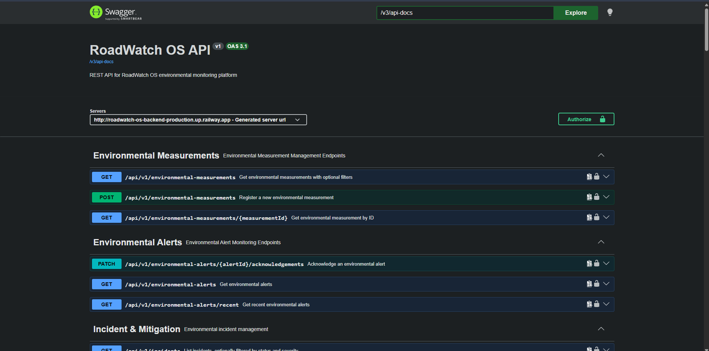
  
  *Figura: documentación OpenAPI publicada en Railway con rutas de mediciones y alertas ambientales.*
  
  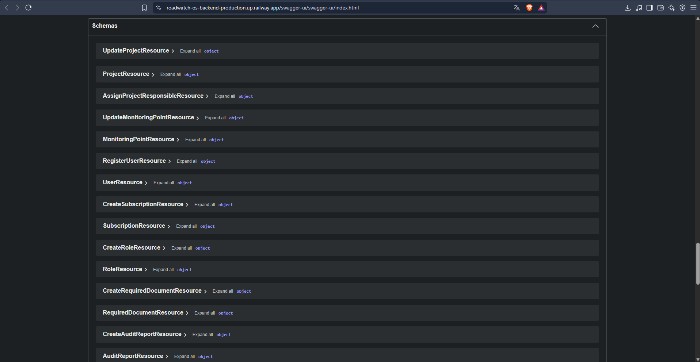
  
  *Figura: esquemas de recursos de Project Management y otros contextos en Swagger UI.*
  
  ---
  
  #### 5.2.3.7. Software Deployment Evidence for Sprint Review
  
  Las capturas del 2026-11-11 documentan la preparación y el despliegue del backend en el proyecto `bubbly-kindness` de Railway, entorno `production`. La primera muestra la pantalla de selección de un repositorio de GitHub; en ese momento la búsqueda aún no devolvía repositorios. Las siguientes muestran el servicio `RoadWatch-OS-Backend` en construcción, la incorporación del servicio MySQL con el volumen `mysql-volume` y su inicialización.
  
  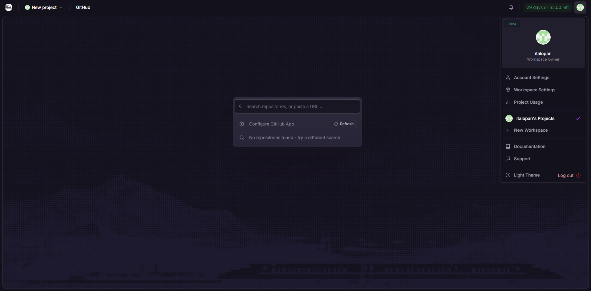
  
  *Figura: pantalla inicial para seleccionar un repositorio de GitHub en Railway.*
  
  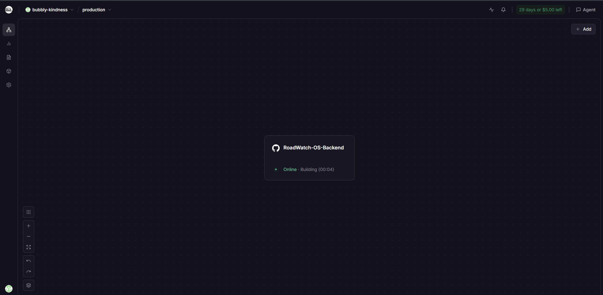
  
  *Figura: servicio RoadWatch-OS-Backend en estado Online mientras Railway muestra Building.*
  
  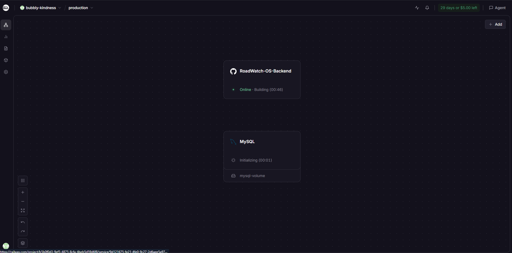
  
  *Figura: incorporación de MySQL y del volumen mysql-volume durante la inicialización.*
  
  En la captura final, **RoadWatch-OS-Backend y MySQL aparecen `Online`** y Railway muestra el aviso `Restart successful`. La imagen respalda que los dos servicios estaban activos en el panel en ese momento. El aviso confirma que se reinició el despliegue; por sí solo no demuestra que los endpoints respondan ni que el backend haya completado una operación de lectura o escritura en MySQL.
  
  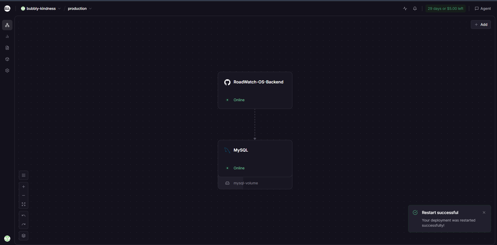
  
  *Figura: ambos servicios en línea en Railway después de un reinicio exitoso.*
  
  La evidencia visual del despliegue queda incorporada al Sprint Review. Las nuevas capturas muestran la instancia MySQL activa, tablas creadas y actividad de recursos; su alcance se explica a continuación. La apertura de Swagger UI en la URL pública de Railway se documenta en la sección anterior. Para acreditar el funcionamiento de la API y su persistencia aún se requiere identificar el commit desplegado y registrar una prueba REST exitosa que lea o escriba datos en MySQL.
  
  Las capturas posteriores de Railway muestran el despliegue `mysql:8` con estado `ACTIVE` y el mensaje `Deployment successful`. En la vista de datos se observan tablas de varios Bounded Contexts, entre ellas `users`, `roles`, `plans`, `subscriptions`, `projects`, `monitoring_points`, `evidences` y `audit_reports`. Esto acredita que la instancia MySQL está disponible y que existen estructuras de persistencia; la imagen no permite verificar el contenido de las filas ni identificar qué versión del backend creó cada tabla.
  
  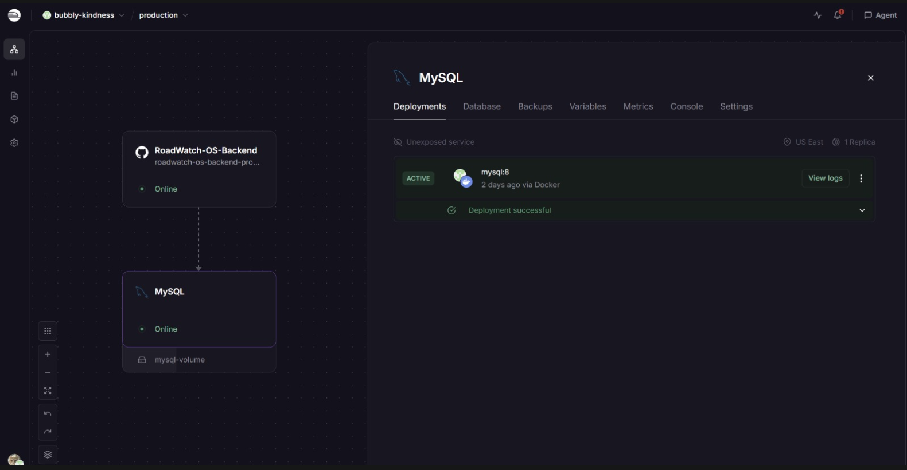
  
  *Figura: servicio MySQL activo y despliegue exitoso en Railway.*
  
  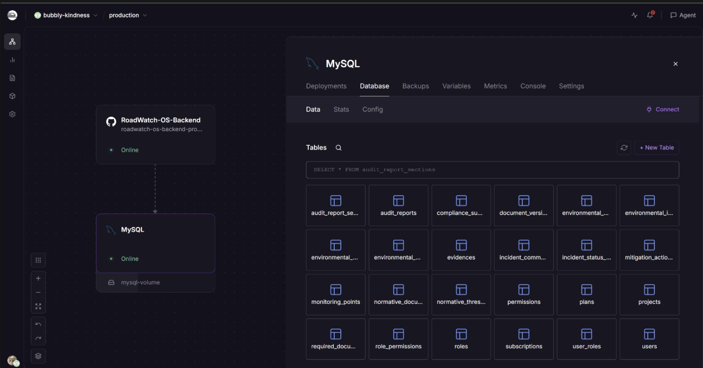
  
  *Figura: tablas de varios Bounded Contexts visibles en la vista de datos de MySQL.*
  
  El panel de métricas registra consumo de memoria y actividad de red de MySQL en el intervalo mostrado. No permite atribuir esa actividad a una petición concreta del backend ni demostrar una operación REST exitosa. La captura de variables de Railway proporcionada por el equipo presenta valores ocultos; no se incorpora al repositorio para evitar publicar información de configuración.
  
  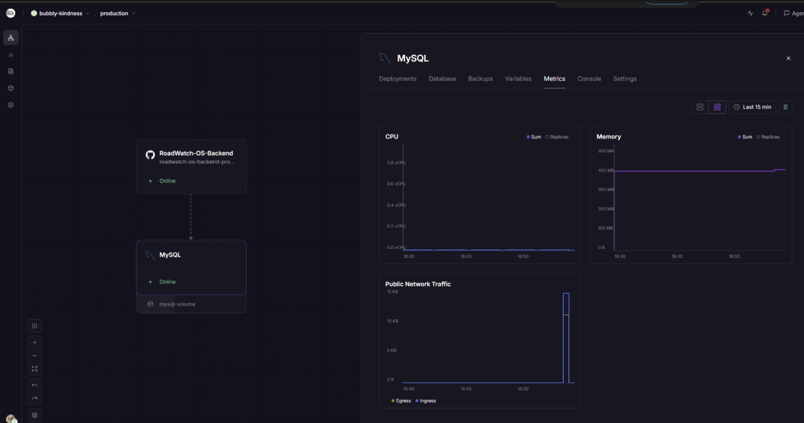
  
  *Figura: métricas de recursos y tráfico del servicio MySQL durante el intervalo observado.*
  
  ---
  
  #### 5.2.3.8. Team Collaboration Insights during Sprint
  
  El backend se desarrolló en ramas por Bounded Context y se integró en `develop` mediante cinco merges registrados entre el 10 y el 11 de noviembre de 2026. La distribución siguiente se basa en la autoría de los commits representativos de la sección 5.2.3.4 y en el historial de integración de la sección 5.2.3.5. Describe contribuciones verificables en Git; no atribuye reuniones, revisiones o acuerdos que no estén documentados.
  
  | Miembro del equipo | Contribuciones observadas en el Sprint 3 |
  |:---|:---|
  | Diaz De La Cruz, Sebastian Gabriel | Implementó Identity & Access y Subscription Management; aportó ajustes a otros contextos y registró los merges de las cinco ramas feature en `develop`, además de los cambios de integración entre alertas, incidencias y evidencias. |
  | Pancorbo Amorós, Italo Raul | Desarrolló el modelo, los servicios y los endpoints REST de Project Management y puntos de monitoreo en `ft-project-management`. |
  | Montes Chang, Piero Francisco | Desarrolló el modelo, los servicios y los endpoints REST de Environmental Monitoring en `ft-environmental-monitoring`. |
  | Cabrera Sotelo, Camila Celeste | Desarrolló el modelo y los endpoints REST de Incident & Mitigation Management en `ft-incident-mitigation`. |
  | Conde Huashuayo, Sebasthian Alex | Desarrolló los recursos de Document & Evidence y Reports & Compliance, incluidas las APIs de documentos y reportes en `ft-document-reports`. |
  
  El trabajo por contexto permitió integrar módulos con responsabilidades separadas. Los commits de `develop` muestran dos conexiones entre contextos: la creación de incidencias a partir de alertas ambientales y la validación de evidencias de incidencias. Estas son observaciones del historial de código; las métricas de colaboración de GitHub y los acuerdos de retrospectiva requieren evidencia propia si el equipo decide incluirlos.
  
  ---
  
  ## 5.3. Validation Interviews
  
  En esta sección se documenta el diseño de las entrevistas de validación de RoadWatch OS y se preparan los registros para los dos segmentos objetivo. Las respuestas, observaciones y evidencias se completarán a partir de las entrevistas realizadas; las tablas siguientes no representan resultados todavía.
  
  ### 5.3.1. Diseño de Entrevistas
  
  Las entrevistas de validación tienen como objetivo evaluar la experiencia de uso de RoadWatch OS mediante la interacción de representantes de los dos segmentos objetivo con el Landing Page y la aplicación web.
  
  Los participantes realizarán tareas específicas utilizando cuentas de prueba con roles diferenciados, de acuerdo con las responsabilidades y funcionalidades correspondientes a cada segmento.
  
  La evaluación permitirá identificar dificultades de navegación, claridad de la información, facilidad de interacción y oportunidades de mejora de la experiencia de usuario.
  
  Las sesiones incluirán tareas de validación, preguntas principales y preguntas complementarias. Se solicitará a los participantes que expresen libremente sus observaciones durante la navegación.
  
  #### Preguntas comunes para ambos segmentos
  
  **Punto a evaluar: Landing Page y acceso a la aplicación.**
  
  **Tarea:** Explorar el Landing Page e identificar la opción de acceso a RoadWatch OS.
  
  1. Al observar la página principal, ¿qué entiendes que ofrece RoadWatch OS?
  2. ¿Los beneficios de la plataforma se presentan de manera clara?
  3. ¿Puedes identificar las principales funcionalidades del producto?
  4. ¿Te resultó sencillo encontrar la opción para ingresar a la plataforma?
  5. ¿Qué información adicional considerarías útil incluir en el Landing Page?
  
  ---
  
  #### Segmento 1: Empresas Constructoras Viales
  
  **Rol de validación:** MANAGER.
  
  **Cuenta de prueba:** `camila.cabrera@roadwatch.demo`
  
  ##### Preguntas principales
  
  ###### Punto 1. Portafolio de proyectos
  
  **Objetivo:** Evaluar la facilidad para localizar proyectos y consultar su información.
  
  **Tarea:** Ingresar a la sección Proyectos, buscar un proyecto, utilizar los filtros disponibles y consultar su detalle.
  
  1. ¿Te resultó sencillo encontrar el proyecto que necesitabas?
  2. ¿La información presentada en el portafolio permite reconocer el estado de los proyectos?
  3. ¿Consideras más clara la visualización en lista o en tarjetas? ¿Por qué?
  
  ###### Punto 2. Dashboard de monitoreo ambiental
  
  **Objetivo:** Evaluar la comprensión de los indicadores ambientales y del estado de las mediciones.
  
  **Tarea:** Ingresar a Monitoreo, revisar el dashboard operativo e identificar mediciones que requieran atención.
  
  4. ¿Los indicadores del dashboard permiten comprender el estado ambiental de las mediciones?
  5. ¿Puedes identificar fácilmente cuáles se encuentran en rango, en advertencia o en estado crítico?
  6. ¿La distribución de la información te permite reconocer rápidamente las situaciones prioritarias?
  
  ###### Punto 3. Centro de alertas
  
  **Objetivo:** Evaluar la identificación y consulta de alertas ambientales.
  
  **Tarea:** Desde Monitoreo, ingresar al centro de alertas y utilizar los filtros Todas, Advertencias y Críticas.
  
  7. ¿Te resultó sencillo encontrar el centro de alertas?
  8. ¿Los filtros permiten identificar claramente las alertas según su nivel de importancia?
  9. ¿La información presentada en la tabla es suficiente para comprender la situación detectada?
  
  ###### Punto 4. Gestión de incidencias
  
  **Objetivo:** Evaluar la consulta y el seguimiento visual de incidencias ambientales.
  
  **Tarea:** Ingresar a Incidencias, revisar el tablero Kanban y seleccionar una incidencia para consultar su detalle.
  
  10. ¿La organización de las incidencias en el tablero resulta clara?
  11. ¿Puedes identificar fácilmente cuáles incidencias están abiertas, en revisión o resueltas?
  12. ¿La pantalla de detalle proporciona información suficiente para comprender el estado de una incidencia?
  
  ###### Punto 5. Evidencias y documentos
  
  **Objetivo:** Evaluar la facilidad para consultar evidencias asociadas con la gestión ambiental.
  
  **Tarea:** Ingresar a Evidencias y documentos, revisar los archivos registrados e identificar las opciones disponibles.
  
  13. ¿Te resultó sencillo encontrar las evidencias registradas?
  14. ¿La información presentada permite identificar los archivos y sus estados?
  15. ¿Consideras clara la organización de esta sección?
  
  ##### Preguntas complementarias
  
  16. ¿Qué funcionalidad consideras más útil para el seguimiento ambiental de una empresa constructora?
  17. ¿Encontraste dificultades al navegar entre las diferentes pantallas?
  18. ¿Qué información adicional necesitarías para realizar tus actividades?
  19. ¿Qué mejorarías de la organización visual de la plataforma?
  20. ¿Consideras que RoadWatch OS podría facilitar el seguimiento ambiental de proyectos viales? ¿Por qué?
  
  ---
  
  #### Segmento 2: Empresas Supervisoras y Consultoras Ambientales
  
  **Rol de validación:** AUDITOR.
  
  **Cuenta de prueba:** `pancho.diaz@roadwatch.demo`
  
  ##### Preguntas principales
  
  ###### Punto 1. Portafolio de proyectos
  
  **Objetivo:** Evaluar la facilidad para consultar y localizar proyectos sujetos a supervisión.
  
  **Tarea:** Ingresar al Portafolio, localizar un proyecto mediante la búsqueda o los filtros y consultar su información.
  
  1. ¿Puedes identificar fácilmente los proyectos disponibles?
  2. ¿Los filtros facilitan la búsqueda de proyectos específicos?
  3. ¿La información presentada permite comprender el estado de cada proyecto?
  
  ###### Punto 2. Historial de mediciones ambientales
  
  **Objetivo:** Evaluar la claridad de los registros históricos y los filtros por indicador ambiental.
  
  **Tarea:** Ingresar a Historial de mediciones y utilizar los filtros Aire, Ruido y Agua para revisar la información registrada.
  
  4. ¿Te resultó sencillo encontrar el historial de mediciones?
  5. ¿Los filtros permiten consultar fácilmente los diferentes indicadores ambientales?
  6. ¿La representación de las mediciones y su evolución temporal resulta clara?
  
  ###### Punto 3. Incidencias críticas
  
  **Objetivo:** Evaluar la facilidad para localizar incidencias que requieren revisión prioritaria.
  
  **Tarea:** Ingresar a Incidencias críticas, localizar el listado correspondiente y consultar el detalle de una incidencia.
  
  7. ¿Te resultó sencillo encontrar las incidencias críticas?
  8. ¿La información presentada permite identificar su gravedad y estado?
  9. ¿El detalle de la incidencia contiene información suficiente para realizar el seguimiento ambiental?
  
  ###### Punto 4. Documentos normativos
  
  **Objetivo:** Evaluar la consulta de documentos normativos y el estado de los hitos de auditoría.
  
  **Tarea:** Ingresar a Documentos normativos, seleccionar un hito de auditoría y consultar el detalle de uno de los documentos.
  
  10. ¿Puedes identificar fácilmente los documentos disponibles?
  11. ¿La organización por hitos de auditoría resulta comprensible?
  12. ¿La información sobre documentos requeridos y pendientes es clara?
  
  ###### Punto 5. Reportes de auditoría
  
  **Objetivo:** Evaluar la facilidad para configurar un expediente de auditoría ambiental.
  
  **Tarea:** Ingresar a Reportes de auditoría, identificar los campos necesarios para seleccionar un proyecto, establecer el periodo y elegir las secciones del expediente.
  
  13. ¿Te resulta claro cómo configurar un nuevo expediente de auditoría?
  14. ¿Las opciones disponibles permiten comprender qué información incluirá el reporte?
  15. ¿El procedimiento de configuración te parece sencillo o modificarías algún paso?
  
  ###### Punto 6. Resumen de cumplimiento
  
  **Objetivo:** Evaluar la consulta de indicadores de cumplimiento y la identificación de proyectos que requieren atención.
  
  **Tarea:** Ingresar a Cumplimiento, revisar los indicadores y utilizar los filtros Todos, Con pendientes y Críticos.
  
  16. ¿Los indicadores presentados permiten comprender el estado de cumplimiento ambiental?
  17. ¿Los filtros facilitan la identificación de proyectos que requieren mayor atención?
  18. ¿Qué información adicional considerarías importante para realizar una supervisión?
  
  ##### Preguntas complementarias
  
  19. ¿Qué funcionalidad consideras más útil para las actividades de supervisión o auditoría ambiental?
  20. ¿Encontraste dificultades para localizar alguna sección de la plataforma?
  21. ¿Consideras clara la organización de la información entre proyectos, mediciones, incidencias y reportes?
  22. ¿Qué funcionalidad o información adicional incorporarías?
  23. ¿Qué aspectos de la experiencia de navegación mejorarías?
  24. ¿Consideras que RoadWatch OS podría facilitar las actividades de supervisión ambiental? ¿Por qué?
  
  ### 5.3.2. Registro de Entrevistas
  
  La primera ficha del Segmento 1 se completó con la grabación de validación del 13 de noviembre de 2026 y con los datos del mismo participante consignados en la entrevista #1 del Segmento 1 del capítulo 2. La navegación de la aplicación fue guiada por el entrevistador; las valoraciones y sugerencias que se atribuyen al participante provienen de sus respuestas. La segunda ficha se completó con el video de validación del Segmento 2; los datos personales que no aparecen en la grabación se dejan expresamente sin confirmar.
  
  **Segmento 1 — Empresas Constructoras Viales**
  
  **Rol previsto en el diseño:** MANAGER. **Cuenta utilizada en la demostración grabada:** administrador.
  
  <table>
  <tr><th colspan="2">Entrevista #1 — Segmento 1 — Empresas Constructoras Viales</th></tr>
  <tr><td><b>Nombre</b></td><td>Luis Alfonso</td></tr>
  <tr><td><b>Apellidos</b></td><td>Chávez Madueño</td></tr>
  <tr><td><b>Edad</b></td><td>52 años (dato registrado en el capítulo 2).</td></tr>
  <tr><td><b>Distrito</b></td><td>Magdalena (dato registrado en el capítulo 2).</td></tr>
  <tr><td><b>Ocupación o cargo</b></td><td>Líder de gestión de proyectos viales, con 10 años de experiencia en el cargo (capítulo 2).</td></tr>
  <tr><td><b>Aplicaciones o herramientas usadas</b></td><td>MS Project y Primavera para planificar y organizar proyectos; correo electrónico para gestiones formales y WhatsApp para consultas rápidas, según la entrevista del capítulo 2.</td></tr>
  <tr><td><b>Motivación</b></td><td>Valora acceder rápidamente al estado de los proyectos, mediciones, alertas e incidencias. Durante la validación destacó la claridad del portafolio, la posibilidad de comparar proyectos en vista de lista o revisar uno en tarjetas, la lectura por colores de los estados ambientales y el acceso a evidencias e historial.</td></tr>
  <tr><td><b>Frustración</b></td><td>Pidió que cada incidencia muestre una causa u origen y una reseña breve antes de abrir todo el detalle o la evidencia. Señaló que los tipos de medición podrían ampliarse según las características de cada proyecto. Durante la demostración, la vista previa del reporte no se cargó; esto fue observado en la sesión y no se atribuye como una evaluación general del participante.</td></tr>
  <tr><td><b>Evidencia de la entrevista</b></td><td>Grabación de pantalla y audio <code>Grabación 2026-11-13 105754.mp4</code>. Se revisaron la Landing Page y las pantallas de proyectos, monitoreo, alertas, incidencias, evidencias, historial, documentos normativos, reportes y cumplimiento. Captura de la sesión durante la revisión del dashboard de monitoreo ambiental:<br>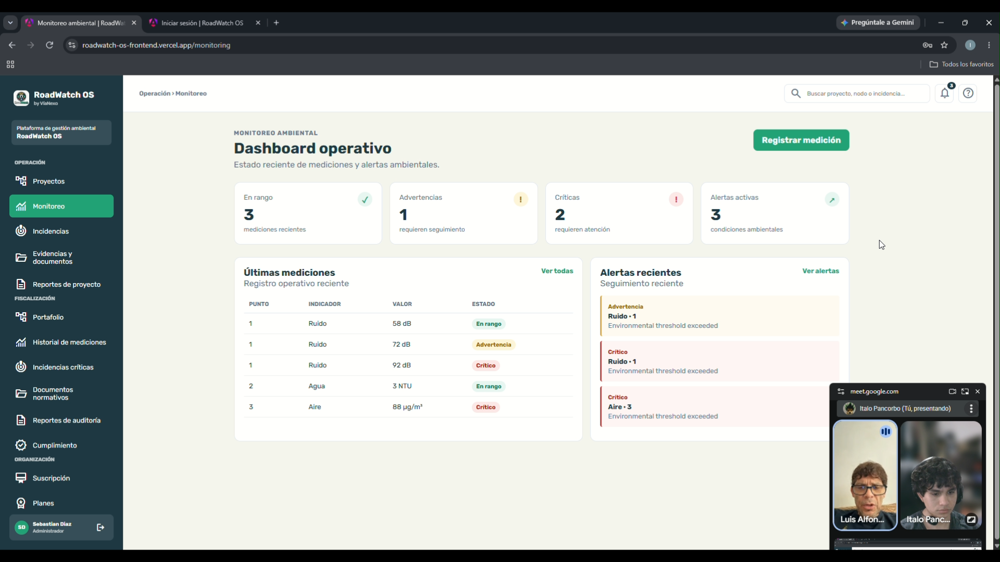</td></tr>
  <tr><td><b>Enlace al video</b></td><td><a href="https://1drv.ms/v/c/113B281D1AF386CE/IQCB0f8yxgWfQL5eUdYlqZ4UAQ2dNnxRUecP-YCOKLZu3Yk?e=eRa2tx">Ver grabación en OneDrive</a>.</td></tr>
  <tr><td><b>Duración</b></td><td>23 min 48 s (duración del archivo).</td></tr>
  <tr><td><b>Resumen</b></td><td>El participante consideró clara la propuesta de la Landing Page y localizó el acceso a la aplicación. Priorizó las mediciones ambientales y las incidencias como funciones relevantes para su trabajo. En el portafolio valoró la información de estado, alertas e incidentes, así como las dos vistas para comparar o profundizar en proyectos. Encontró comprensibles los indicadores y filtros del monitoreo y las alertas, y útiles las evidencias descargables y el historial de mediciones. Como mejora concreta, recomendó mostrar el origen y una descripción breve de cada incidencia y permitir mediciones adicionales cuando el proyecto lo requiera. Al cierre describió la interfaz como clara y fácil de usar, y manifestó disposición a utilizarla.</td></tr>
  </table>
  
  <table>
  <tr><th colspan="2">Entrevista #2 — Segmento 1 — Empresas Constructoras Viales</th></tr>
  <tr><td><b>Nombre</b></td><td>Alexandra</td></tr>
  <tr><td><b>Apellidos</b></td><td>Ojeda</td></tr>
  <tr><td><b>Edad</b></td><td>Dato no especificado en la transcripción.</td></tr>
  <tr><td><b>Distrito</b></td><td>Dato no especificado en la transcripción.</td></tr>
  <tr><td><b>Ocupación o cargo</b></td><td>Representante de empresa constructora vial (sesión realizada bajo el rol de MANAGER).</td></tr>
  <tr><td><b>Aplicaciones o herramientas usadas</b></td><td>Dato no especificado en la transcripción; validó directamente la plataforma RoadWatch OS.</td></tr>
  <tr><td><b>Motivación</b></td><td>Valora tener la información ambiental centralizada en un solo lugar. Destacó la utilidad de la vista de lista para comparar proyectos rápidamente, el uso de filtros en el Centro de alertas para priorizar situaciones críticas y la vista de tablero (Kanban) para entender de un vistazo la etapa y estado de cada incidencia.</td></tr>
  <tr><td><b>Frustración / Oportunidad de mejora</b></td><td>Señaló que, además de mostrar el estado general o crítico, la plataforma debería indicar de forma más visible qué acción o siguientes pasos debe realizar el responsable tras detectar una alerta o una incidencia crítica.</td></tr>
  <tr><td><b>Evidencia de la entrevista</b></td><td>Grabación de pantalla y audio de la evaluación. Se revisaron la Landing Page, portafolio de proyectos, monitoreo ambiental, centro de alertas, incidencias, y evidencias y documentos.<br><br>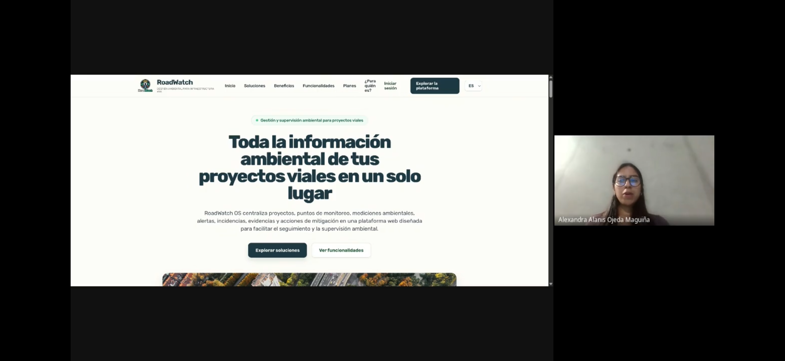</td></tr>
  <tr><td><b>Enlace al video</b></td><td><a href="https://upcedupe-my.sharepoint.com/:v:/g/personal/u20241g031_upc_edu_pe/IQBwKceYtUksQYnne1fwPT9AAdl9I2SEgCI_u-6XKf7DCCg?e=HSHvhS">Ver grabación en SharePoint</a>.</td></tr>
  <tr><td><b>Duración</b></td><td>Aprox. 3 a 5 minutos (tiempo objetivo establecido en la sesión).</td></tr>
  <tr><td><b>Resumen</b></td><td>La participante comprendió rápidamente el propósito de la Landing Page y el público objetivo. Durante la navegación, interactuó fluidamente con el portafolio, indicando su preferencia por la vista de lista para comparar datos. Identificó con éxito los estados de las mediciones y utilizó los filtros del Centro de alertas para aislar los casos críticos. Encontró muy clara la organización por columnas de las incidencias. Como mejora principal, propuso incluir recomendaciones de acción concretas frente a alertas de prioridad alta. Concluyó que RoadWatch OS es muy útil porque centraliza información que típicamente se encuentra dispersa entre reportes y encargados, facilitando enormemente el seguimiento y la toma de decisiones.</td></tr>
  </table>
  **Segmento 2 — Empresas Supervisoras y Consultoras Ambientales**
  
  **Rol utilizado en la prueba:** AUDITOR. El entrevistador llama “Fabio” al participante en la grabación. No corresponde a Angiela Fuentes Alvarez, registrada como entrevista #1 de este segmento en el capítulo 2; por ello, no se trasladan sus datos personales a esta ficha.
  
  <table>
  <tr><th colspan="2">Entrevista #1 — Segmento 2 — Empresas Supervisoras y Consultoras Ambientales</th></tr>
  <tr><td><b>Nombre</b></td><td>Fabio (nombre usado por el entrevistador en el video).</td></tr>
  <tr><td><b>Apellidos</b></td><td>No informados en la grabación.</td></tr>
  <tr><td><b>Edad</b></td><td>No informada en la grabación.</td></tr>
  <tr><td><b>Distrito</b></td><td>No informado en la grabación.</td></tr>
  <tr><td><b>Ocupación o cargo</b></td><td>Participó desde la perspectiva de una empresa supervisora o consultora ambiental; no se indicó su cargo real.</td></tr>
  <tr><td><b>Aplicaciones o herramientas usadas</b></td><td>No mencionó nombres de herramientas que utilice personalmente. Señaló la utilidad de consultar registros y documentos de respaldo sin depender de archivos enviados por separado.</td></tr>
  <tr><td><b>Motivación</b></td><td>Consideró útil centralizar información ambiental para revisar varios proyectos y preparar auditorías. Valoró la búsqueda del portafolio, la separación del historial por componente ambiental, la organización de documentos por hito de auditoría y el resumen de cumplimiento para decidir dónde concentrar la revisión.</td></tr>
  <tr><td><b>Frustración</b></td><td>Pidió mostrar unidades y límites de referencia junto a las mediciones; un historial de acciones de incidencias con fechas, responsables y distinción entre medidas propuestas y ejecutadas; la versión vigente y las observaciones de cada documento; un resumen previo al generar el expediente; y accesos desde los indicadores de cumplimiento hasta los pendientes y documentos que explican cada resultado.</td></tr>
  <tr><td><b>Evidencia de la entrevista</b></td><td>Video <code>Video Project 1.mp4</code> y captura proporcionada de la sesión durante la revisión del portafolio de proyectos. Captura de la revisión del portafolio:<br>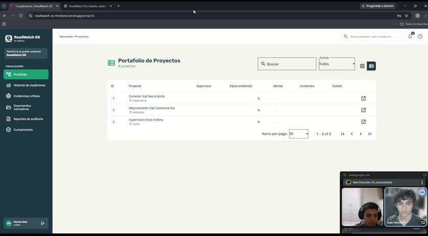</td></tr>
  <tr><td><b>Enlace al video</b></td><td><a href="https://1drv.ms/v/c/113B281D1AF386CE/IQBDCHbWA_ctTLGyzkoQZ6cQAQfKLGio0Fs2fa5OnTfZ1lA?e=ZDMWNZ">Ver grabación en OneDrive</a>.</td></tr>
  <tr><td><b>Duración</b></td><td>4 min 49 s (duración del archivo).</td></tr>
  <tr><td><b>Resumen</b></td><td>El participante identificó el acceso desde la Landing Page y distinguió las áreas dirigidas a constructoras y a supervisión. En el portafolio usaría la búsqueda, el estado y las alertas antes de abrir un proyecto. En el historial de mediciones revisaría agua, fechas y puntos para identificar variaciones; pidió contexto de unidades y límites. Para incidencias críticas priorizó gravedad, estado, fecha, acciones, responsables y evidencias. Encontró comprensible organizar documentos por hitos y configurar el reporte por proyecto, periodo y secciones, aunque recomendó destacar versiones vigentes y verificar la selección antes de generar el expediente. Valoró el resumen de cumplimiento, pero pidió navegación directa hacia las observaciones y sus respaldos. Consideró que RoadWatch OS podría reducir el tiempo de reunir información y facilitar el seguimiento, siempre que los registros estén actualizados y sea posible rastrear el origen de cada dato.</td></tr>
  </table>
  
  <table>
  <tr><th colspan="2">Entrevista #2 — Segmento 2 — Empresas Supervisoras y Consultoras Ambientales</th></tr>
  <tr><td><b>Nombre</b></td><td>Angie</td></tr>
  <tr><td><b>Apellidos</b></td><td>Cuya</td></tr>
  <tr><td><b>Edad</b></td><td>Dato no especificado en la transcripción.</td></tr>
  <tr><td><b>Distrito</b></td><td>Dato no especificado en la transcripción.</td></tr>
  <tr><td><b>Ocupación o cargo</b></td><td>Representante de empresa supervisora y consultora ambiental (sesión realizada bajo el rol de AUDITOR).</td></tr>
  <tr><td><b>Aplicaciones o herramientas usadas</b></td><td>Dato no especificado en la transcripción; validó directamente la plataforma RoadWatch OS.</td></tr>
  <tr><td><b>Motivación</b></td><td>Valora que la plataforma reúna información operativa y de fiscalización en un solo lugar. Destacó la utilidad de ver la evolución temporal mediante filtros (aire, ruido, agua) en el historial de mediciones, la organización clara de los documentos normativos y el proceso guiado paso a paso para generar reportes de auditoría.</td></tr>
  <tr><td><b>Frustración / Oportunidad de mejora</b></td><td>Sugirió mejorar la conexión visual entre las incidencias críticas y sus evidencias o documentos vinculados para un acceso más rápido. En el módulo de reportes, recomendó agregar un buscador o ayuda visual para seleccionar el proyecto, evitando tener que recordar o ingresar manualmente su identificador.</td></tr>
  <tr><td><b>Evidencia de la entrevista</b></td><td>Grabación de pantalla y audio de la evaluación. Se revisaron la Landing Page, portafolio de proyectos, historial de mediciones, incidencias críticas, documentos normativos y reportes de auditoría.<br><br>
  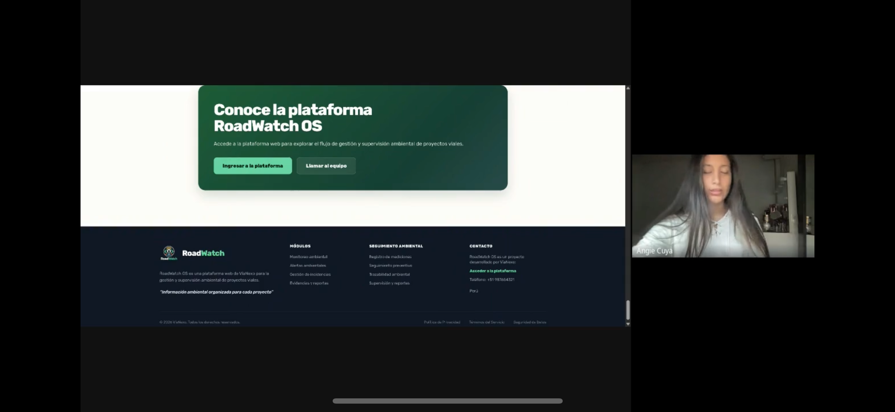</td></tr>
  <tr><td><b>Enlace al video</b></td><td><a href="https://upcedupe-my.sharepoint.com/:v:/g/personal/u20241g031_upc_edu_pe/IQCNFffK_lqoTZJj9FQ2qr8gATUKWnJMGmx5yxSGesEvLCU?e=ZQPETb">Ver grabación en SharePoint</a>.</td></tr>
  <tr><td><b>Duración</b></td><td>Aprox. 3 a 5 minutos (tiempo objetivo establecido en la sesión).</td></tr>
  <tr><td><b>Resumen</b></td><td>La participante comprendió la propuesta de valor para el perfil de auditoría y fiscalización. Navegó fluidamente por el portafolio y el historial de mediciones, resaltando la practicidad de los filtros y las gráficas de evolución temporal. Localizó rápidamente las incidencias críticas, aunque sugirió que el acceso a sus respectivas evidencias sea más directo. Valoró la separación entre documentos normativos y evidencias operativas. En la generación de reportes, encontró muy lógico el flujo de pasos, pero propuso incluir un buscador de proyectos por nombre. Finalizó destacando que la herramienta facilita enormemente la labor de supervisión al centralizar alertas, mediciones y documentos de soporte en un solo entorno organizado.</td></tr>
  </table>


### 5.4. Video About-the-Product

Como parte de la entrega AV2, el equipo de **VíaNexo** elaboró el video *About-the-Product* de **RoadWatch OS**, cuyo propósito es presentar la propuesta de valor de la plataforma y comunicar sus principales funcionalidades a los segmentos objetivo: empresas constructoras viales y empresas supervisoras y consultoras ambientales.

RoadWatch OS propone una solución digital para centralizar la gestión de proyectos viales, el monitoreo ambiental, el seguimiento de alertas e incidencias, la administración de evidencias y documentos normativos, y la generación de reportes de cumplimiento.

El video está dirigido a potenciales usuarios y clientes, utilizando un lenguaje claro y accesible para comunicar los beneficios de la solución y su aporte a la eficiencia operativa, trazabilidad de la información y toma de decisiones.

#### Evidencia del video

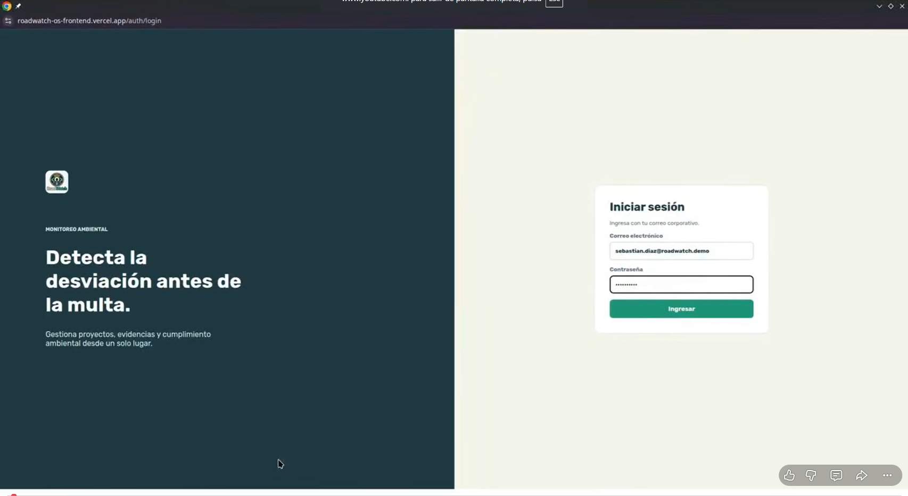

*Figura: Captura representativa del video About-the-Product de RoadWatch OS.*

| Elemento | Descripción |
|:---|:---|
| **Título** | RoadWatch OS – About-the-Product |
| **Startup** | VíaNexo |
| **Duración** | 05:00 minutos |
| **Entrega** | AV2 |
| **Microsoft Stream** | [Ver video en Microsoft Stream](https://upcedupe-my.sharepoint.com/:v:/g/personal/u202410421_upc_edu_pe/IQDrL1dLRqU-SKn2kd0TEq0JAYzZsyz2tN2wUUkIwW8EH7k?nav=eyJyZWZlcnJhbEluZm8iOnsicmVmZXJyYWxBcHAiOiJTdHJlYW1XZWJBcHAiLCJyZWZlcnJhbFZpZXciOiJTaGFyZURpYWxvZy1MaW5rIiwicmVmZXJycmFsTW9kZSI6IldlYiIsInJlZmVycmFsTW9kZSI6IldlYiIsInJlZmVycmFsQXBwUGxhdGZvcm0iOiJXZWIiLCJyZWZlcnJhbE1vZGUiOiJ2aWV3In19&e=AB0p8t) |
| **YouTube** | [Ver video en YouTube](https://youtu.be/-9enNXuyJ3s) |

El material audiovisual constituye una evidencia de la comunicación de la propuesta de solución de RoadWatch OS y complementa la documentación técnica y funcional desarrollada durante el proyecto.

---
